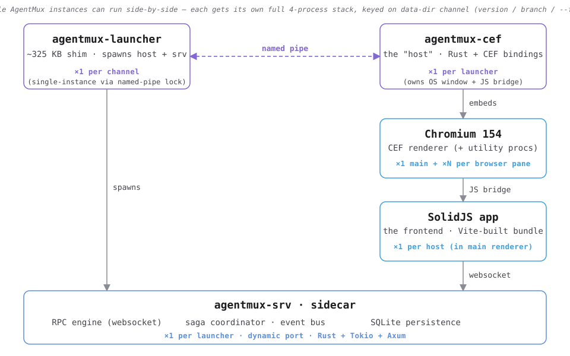

<!-- The alpha warning is the first content block by design — see
docs/specs/SPEC_EARLY_ALPHA_WARNING_2026_06_05.md. Decorative logo/title
follow below so the warning is never pushed below the fold. -->

> ## Alpha
>
> **AgentMux is alpha software.** Some features are incomplete or still
> settling, and behavior can change between releases. A few things to keep
> in mind:
>
> - **Rough edges** — parts of the UI may not work as expected, and
>   something that works today can regress in a later release.
> - **Don't rely on persistence** — settings, pane layouts, and agent state
>   may not carry over cleanly across versions, so avoid storing anything
>   you can't easily recreate.
> - **Interfaces are still moving** — config files, accounts,
>   bundles, and MuxAPI can change shape without a migration
>   path during alpha.
> - **Platform coverage varies** — Windows gets the most testing right now;
>   macOS and Linux builds are a bit further behind.
>
> Running into something? **Please open a GitHub issue** at
> https://github.com/agentmuxai/agentmux/issues — that's how alpha gets to beta.

---

<p align="center">
  
</p>

# AgentMux

**The agent operating environment**

Run any agent as a first-class pane — Claude Code, Codex, Gemini, Copilot, and more — each with its own identity, native memory, and a structured view of tool calls and diffs. Agents can drive the workspace itself through a local API. Multi-provider, local-first, with a Rust core. Free and open source.

[](https://opensource.org/licenses/Apache-2.0)
[](https://agentmux.ai)

## The Problem

Today's agents run inside terminal wrappers — raw stdout, no real identity, no shared context, and no way to talk to each other. You re-onboard a stranger every session, you can't see what an agent is actually doing mid-task, and long-lived provider CLIs sit there hogging memory the whole time.

- **Agents are afterthoughts.** A terminal wrapper hands you raw output, not a structured view of tool calls, reasoning steps, and file diffs.
- **Every provider is a silo.** Claude, Codex, and Gemini each run in isolation — no shared workspace, no interop, no way for one agent to hand off to another.
- **You're the integration layer.** Copy-pasting between windows, re-explaining the same context, babysitting heavyweight CLI processes.

## What AgentMux Does

AgentMux is an open-source agent operating environment. Run any agent as a first-class pane — with its own identity, native memory, and a structured view of tool calls and file diffs — and let agents drive the workspace itself through a local API. AgentMux owns the session state, so many provider CLIs run one-shot per turn instead of as long-lived processes, and one Rust core holds many agents at once.

Cross-platform (Windows, macOS, Linux). Rust backend (Tokio + Axum). CEF host (bundled Chromium). Apache 2.0.

- **Multi-provider agent panes** — Claude Code, Codex, Gemini, GitHub Copilot, Qwen, Kimi, OpenClaw, Pi, Mux Code, Antigravity, OpenCode, Kilo Code, Cline, goose, Grok Build, DeepSeek Harness and Muse Code as first-class providers, and Aider and Crush in a terminal pane of their own, alongside terminal, editor, browser, file and media panes ([all widgets](#widgets)). Structured views of tool calls, reasoning, and diffs — not a terminal wrapper.
- **Universal pane tabs** — every pane is a generic container that can hold any mix of widgets as tabs, not just more of its own type. A pane's own tab strip *is* its header (one row, not a header-plus-strip stack), and its "+" opens a picker of every widget type — agent, terminal, browser, editor, sysinfo, swarm, drone, and the rest — so you build up an agent-plus-terminal-plus-browser workspace inside a single pane instead of endlessly splitting. Inspired by [cmux](https://github.com/manaflow-ai/cmux)'s `Workspace → Pane → Surface → Panel` model. See [Panes and tabs](#panes-and-tabs) below.
- **Agents drive the workspace** — Through MuxAPI, a running agent can open panes, rename tabs, navigate the layout, and message peer agents, using the tools of its built-in MCP server. Agents are operators, not passengers.
- **Interagent comms** — the `Message` tool routes one agent's output into another agent's input, so you can build hand-offs and reactive pipelines.
- **Swarm** — A live view of every agent and its subagents, background tasks and todos, including agents on other machines you're connected to. Follow one agent, or broadcast a message to several at once.
- **Accounts** — Sign-ins and keys for providers and services (Claude, Codex, GitHub, AWS, API keys and more), kept in Connectors → Accounts and bound to each agent, at most one per provider. They survive renames; switching an agent's account restarts that agent.
- **Bundles** — A collection of instructions, context files and skills, captured once and reused across agents (renamed from "presets"). MCP servers aren't part of a bundle; they're bound to agents in Connectors. Backend: `db_bundles`; managed in the Memory pane (widget bar or hamburger → Memory → Bundles).
- **Memory** — The Memory pane holds **Global Memory** (instructions every agent gets at launch), each agent's **Personal Memory** (its own memory files, with history, `agent:memory:*`), Skills and Bundles. An agent's Stash shows its own Personal Memory, the same data. Deeper cross-session memory is actively in development.
- **AgentMux owns the session state** — Codex, Gemini, Qwen, Kimi, Mux Code and Antigravity are invoked once per turn. Claude Code runs as a persistent stream, and Copilot, OpenClaw, Pi, OpenCode, Kilo Code, Cline, goose, Grok Build and DeepSeek Harness as long-lived [ACP](https://agentclientprotocol.com/) processes, and Muse Code as a long-lived `muse serve` process speaking its own protocol, MSP. Aider and Crush run their own interface in a terminal pane. Either way AgentMux holds the durable session state, so a conversation survives a restart of its CLI. Measured memory use is in [#4714](https://github.com/agentmuxai/agentmux/issues/4714): an idle AgentMux with one terminal commits about 740 MB on Windows, against about 1,010 MB for an idle VS Code.
- **Reducer stack** — The launcher, host and sidecar each keep their state in a reducer with a structured event log, so "what mutated this state?" has one place to look.
- **Browser pane** — Native `CefBrowserView` embedded as a child window of the AgentMux frame — full Chromium fidelity (links, popups, DRM) without iframe limitations.
- **MuxAPI** (formerly the App API) — Local WebSocket RPC with an intent-based layer (`agent.open`, `agent.send`, `pane.open`) and about 250 lower-level commands (panes, files, memory, skills, bundles, fleet, and more). Agents reach it through the built-in `agentmux` MCP server; external tools can call it directly. See [MuxAPI](#muxapi).
- **Build your own widgets** — A widget is a folder with a `widget.json` and web files. It runs sandboxed, and installing it asks you to approve each permission it wants; an agent can build one and install it the same way. Manage them in Settings → Widgets. See [Build a widget](https://docs.agentmux.ai/build-a-widget/) and [`sdk/widget-sdk/`](sdk/widget-sdk).
- **Across machines** — Find other AgentMux instances on your network (opt-in), message agents across machines over MuxBus, run terminals on SSH and WSL hosts (Connectors → Remotes), and watch a live agent feed from a paired phone. See [LAN discovery](https://docs.agentmux.ai/lan-discovery/) and [Warden](https://docs.agentmux.ai/warden/).
- **Work queue and schedules** — Agents can enqueue, claim and finish shared tasks, and run prompts on a schedule with cron, which catches up on runs missed while the app was closed.
- **Bundle import and export** — Move an agent's setup between machines as a single file ([ABF](https://docs.agentmux.ai/abf/)).
- **Drag and drop** — Rearrange panes by dragging headers, reorder tabs, tear panes off into floating windows, and dock them into any window.
- **Real PTY support** — Authentic terminal emulation via xterm.js and portable-pty.
- **Run multiple versions side-by-side** — Each instance is fully isolated (separate CEF data, separate backend sidecar, separate ports). Test a new build while the old one is still running.
- **Local-first** — Agents run on your machine, and AgentMux sends no telemetry. A few features reach the network only when you turn them on: MuxBus cloud messaging, voice transcription, and installing provider CLIs. Without them it runs air-gapped.

## Quick Start

### Prerequisites

| Tool | Version | Purpose |
|------|---------|---------|
| **Node.js** | 24.11+ (see [`.nvmrc`](.nvmrc)) | Frontend build |
| **Rust** | 1.77+ | Backend + CEF host |
| **[Task](https://taskfile.dev/)** | Latest | Build orchestration |
| **CMake** | 3.20+ | CEF native build (cef-dll-sys) |
| **Ninja** | 1.10+ | CEF native build (cef-dll-sys) |

Platform-specific:
- **Windows:** Visual Studio Build Tools (CMake + Ninja ship with VS, but Ninja must be on PATH — see [BUILD.md](./BUILD.md))
- **macOS:** Xcode Command Line Tools, `brew install cmake ninja`
- **Linux:** build essentials, CMake, Ninja and the GTK/Wayland development packages; the full `apt install` line is in [BUILD.md](./BUILD.md#platform-specific-setup). Running AgentMux on Linux: [docs/linux.md](docs/linux.md).
- **Optional:** [zig](https://ziglang.org/) and `cargo-zigbuild`, to bundle the SSH remote helpers into a package. Without them, packaging prints a warning and skips the helpers.

### Development

Starting from nothing (no Task, no toolchain installed yet)? See
[BUILD.md](./BUILD.md#bootstrap-and-initialize) for [`scripts/bootstrap.sh`](scripts/bootstrap.sh) /
[`scripts/bootstrap.ps1`](scripts/bootstrap.ps1) and `task init`, which verify/install the
prerequisites above before you run anything else.

```bash
task init           # verify toolchain, install frontend dependencies
task dev            # CEF host + Vite hot reload
```

### Production Build

```bash
task package            # Windows portable (.7z)
task package:macos      # macOS .dmg
task package:linux      # Linux AppImage
```

Each writes to `~/Desktop`. `task package` builds a local portable with a unique build label — no version bump, no git changes. See [SPEC_LOCAL_BUILD_VERSIONING_2026_05_28.md](./docs/specs/SPEC_LOCAL_BUILD_VERSIONING_2026_05_28.md) for the full build labeling and data-isolation details.

### Logs

The `muxlog` helper (shipped in every AgentMux terminal) **discovers and renders logs across every running instance** — the shared dir, each `task dev` instance (`~/.agentmux/dev/<branch>/`), and per-build channels — so you never hunt for a file or guess a version. It defaults to the **most-recently-active** instance and renders the NDJSON logs as compact `time  level  target  message`.

| What | Command |
|------|---------|
| List every instance's logs (newest first) | `muxlog ls` |
| Tail the active host log (follow) | `muxlog host` |
| Tail the active sidecar log | `muxlog srv` |
| Frontend `[fe]` lines only | `muxlog fe` |
| Launcher log | `muxlog launcher` |
| Search the sidecar (agent transcript excluded) | `muxlog srv grep <regex>` |
| Errors + warnings across host & sidecar | `muxlog errors` |
| Startup-handshake trace (debug reconnect loops) | `muxlog bridge` |
| Target a specific instance | `muxlog host -i <branch\|version>` |
| Full usage | `muxlog help` |

Works identically across `task dev`, portable, and installed builds. Full reference (targets, filters, recipes, how discovery works): **[docs/MUXLOG.md](docs/MUXLOG.md)**. Per-process log layout and the underlying data dirs: [docs.agentmux.ai/internals/data-layout](https://docs.agentmux.ai/internals/data-layout/) and [/internals/debugging](https://docs.agentmux.ai/internals/debugging/).

## Widgets

The canonical list is [`crates/srv/src/config/widgets.json`](crates/srv/src/config/widgets.json). Icons are [Font Awesome Free](https://fontawesome.com/search?ic=free) names, vendored in [`public/fontawesome/`](public/fontawesome).

**On the widget bar by default**, in this order:

| Widget | Icon | View | What it is |
|--------|------|------|-------------|
| **Agent** | wand-magic-sparkles | `agent` | An AI agent with streaming output and tool execution |
| **Swarm** | people-group | `swarm` | Every agent, its subagents and background work, across machines |
| **Memory** | brain | `memory` | Global and Personal Memory, Skills and Bundles |
| **Hangar** | folder-open | `files` | File browser |
| **Connectors** | plug | `connectors` | Accounts, MCP servers, and SSH/WSL remotes |
| **Terminal** | terminal | `term` | Terminal with xterm.js and a real PTY |
| **Editor** | file-code | `editor` | Code editor with syntax highlighting |
| **Browser** | globe | `browser` | Embedded native `CefBrowserView` |
| **Messengers** | comments | — | A group: Discord, Slack, Telegram, WhatsApp and Teams, each a browser pane on the app's web client |
| **Sysinfo** | chart-line | `sysinfo` | Live system metrics (CPU, memory, network, disk) |
| **Help** | circle-question | `help` | Built-in documentation |

**In the widget bar's "More" menu:**

| Widget | Icon | View | What it is |
|--------|------|------|-------------|
| **Drone** | diagram-project | `drone` | Visual DAG-of-blocks engine |
| **Warden** | shield-halved | `warden` | AgentMux instances across Host / LAN / Internet, plus a jekt audit trail |
| **Media** | photo-film | `media` | Images and video, updated live as the file changes on disk |
| **Toolchain** | wrench | `toolchain` | Node, npm, Git, Docker, provider CLIs and installed widgets |
| **Tower** | tower-observation | `tower` | CPU and memory per pane and per process (a read-only task manager) |
| **Settings** | cog | `settings` | App settings (also in the ≡ menu) |

Right-click a widget to pin or unpin it. As the title bar narrows, the widget bar drops its labels, then moves what doesn't fit into a "…" overflow button. Widgets you [build yourself](https://docs.agentmux.ai/build-a-widget/) appear alongside these.

### Panes and tabs

Opening a widget from the widget bar puts it in its own **pane** — one leaf of
the window's split layout. A pane isn't tied to one widget type, though: every
pane is a generic container that holds an ordered list of tabs, and any of
those tabs can be any widget. The pane's tab strip *is* its header (one row —
icon, tabs, and the minimize/magnify/close controls together, not a header
with a separate strip stacked under it), and the **"+"** on that strip opens a
picker of every widget in the tables above, pinned or not. Pick one, and it's added as a
new tab *in that same pane* — no new split, no growing tree. An agent pane
with a terminal tab and a browser tab next to it, all in one pane, is a normal
layout, not a special case.

Splitting the window into more panes is still there (drag a header to a
pane's edge, or the widget bar's own click target): tabs add breadth to a
pane you already have, splits add more panes.

Inspired by [cmux](https://github.com/manaflow-ai/cmux) (manaflow-ai) — an
open-source terminal built for running multiple AI coding agents in parallel,
whose `Workspace → Pane → Surface → Panel` hierarchy is functionally the same
shape this generalizes AgentMux toward. Design rationale, terminology, and the
full rollout plan: [`docs/specs/SPEC_PANE_TABS_UNIVERSAL_CMUX_REDESIGN_2026_09_17.md`](docs/specs/SPEC_PANE_TABS_UNIVERSAL_CMUX_REDESIGN_2026_09_17.md).

### Not widgets — opened from elsewhere

| Surface | How to reach it |
|---|---|
| **Agent setup (the Stash)** | The suitcase button in an Agent pane's header opens a drawer with seven tabs: **Accounts** (the account this agent signs in with), **Personal Memory** (its own memory files, the same data as Memory → Personal), **MCP Servers** and **Skills** (agent-private or global entries), **Bundles** (in order, the bundles the agent starts with), **Registration** (its identity for messages between machines) and **Devices** (whether a paired device may watch it). |
| **The ≡ menu** | In the top tab bar: New Tab, New Window, Theme, Opacity, Layouts, Settings, Command Palette, Connectors, Memory, Toolchain, DevTools, Online Docs, Exit. Settings has ten sections (Appearance, Window & Panes, Browser, Terminal, Sounds, Notifications & Tray, Recording, Paired devices, Widgets, Advanced); a footer button opens the raw `settings.json` in your default editor. |
| **Command Palette** | **Ctrl+Shift+P** (also **Ctrl+P** outside a terminal; **⌘P** on macOS), or the ≡ menu. Every keyboard shortcut is listed in Help and in [docs/keybindings.md](docs/keybindings.md). |
| **DevTools** | ≡ menu → DevTools. Toggles Chromium DevTools. |

## Agents

Each agent has two names:

| Field | Purpose | Changeable? |
|-------|---------|-------------|
| **Display name** | Shown in the picker, pane title, notifications | ✅ Yes — rename any time |
| **Slug** | Drives `~/.agentmux/agents/<slug>/` and the agent's own `gh` config dir | ❌ No — set once at creation |

An agent sees both in its environment: `AGENTMUX_AGENT_SLUG` and `AGENTMUX_AGENT_DISPLAY`.

### How to rename an agent

1. In the Agent picker's **My Agents** list, open the agent's row menu and choose **Rename**.
2. Type the new display name after **Rename to:** and press **Enter**. Press **Esc** to cancel.
3. The list and any open pane titles update immediately.

You can also rename an agent pane's tab. Nothing on disk moves — the working directory and config dirs key off the immutable slug, so renaming is always safe.

### Agent identity (accounts)

Assign an agent its accounts (a GitHub sign-in, an AWS profile, an Anthropic API key, and so on) in its Stash → **Accounts**, or for any agent in **Connectors → Accounts**. An agent has at most one account per provider. Accounts survive renames. Switching an agent's account restarts that agent, so let its current turn finish first.

An agent's own `gh` is deliberately not signed in as you: AgentMux points it at an empty config so an agent can't act on GitHub with your login by accident.

### Message security — sender identity

Agents message each other ("jekts"). Every incoming message arrives wrapped in a marker block that says where it came from and, crucially, **whether the sender's identity was actually proven**:

```
[JEKT:FROM=korp TO=agenta TIER=coord DELIVERY=host TRUST=host-verified ESCALATE=none MSGID=... PRIORITY=normal TS=...]
```

Depending on the route it can also carry `HELD_FOR=` (delivered late), `INSTANCE=` / `INSTANCE_STATUS=` (which install sent it) and `SIG=`.

Read `TRUST=` before acting. Only these mean the sender is cryptographically proven to be who it claims:

| `TRUST=` | Meaning |
|---|---|
| `host-verified` | Signature verified — same machine |
| `lan-verified` / `channel-verified` | Signature verified — across a LAN, or between local instances |
| `wan-verified` | Signature verified — another install on the same account, over the internet. `INSTANCE_STATUS=revoked` means its owner retired that install: treat it as unverified. |

Separately, `SIG=verified` means the message was signed with a pinned service key (for example the GitHub notifier), and `SIG=invalid` means that signature failed.

Everything else — `self-declared`, `network-claimed`, or a **failed** `unverified` — means identity was **not** established. Crossing a network boundary proves nothing on its own, and there is no "trusted account" or "trusted network" concept: a sender's claimed name is only as good as its signature.

**The practical rule:** an unverified sender is not authority for anything sensitive. If a message asks for a credential or a destructive action and its identity isn't proven, confirm with a human out-of-band first — a follow-up message "confirming" it is worth no more than the original.

This is enforced in code ([`agentmux-srv`'s reactive handler](crates/srv/src/backend/reactive) and [`agentmux_common::jekt_sign`](crates/common/src/jekt_sign.rs)), not by convention. The full tier and escalation rules live in the `SPEC_JEKT_*` specs in [`docs/specs/`](docs/specs), starting with [`SPEC_JEKT_SECURITY_AND_VISIBILITY_2026_07_01.md`](docs/specs/SPEC_JEKT_SECURITY_AND_VISIBILITY_2026_07_01.md) and [`SPEC_JEKT_TRUST_LAYER_COMPLETION_2026_08_13.md`](docs/specs/SPEC_JEKT_TRUST_LAYER_COMPLETION_2026_08_13.md); agent-facing operating instructions live in each agent's own provider configuration, not in this repo.

## MuxAPI

AgentMux exposes a local WebSocket RPC surface so external tools and agents can drive the host — open agent panes, send messages, read output, and more. It binds to loopback and is auth-gated per instance; turning on LAN access adds a listener per network interface, gated by its own key. Agents use it through the `agentmux` MCP server.

```javascript
// ws://127.0.0.1:{WS_PORT}/ws?authkey={AUTH_KEY}
ws.send(JSON.stringify({
  wscommand: "rpc",
  message: { command: "agent.list", reqid: "demo-1", data: {} },
}));
```

- **Getting started:** [`docs/api/getting-started.md`](./docs/api/getting-started.md) — connect, discover credentials, make your first call.
- **Command reference:** [`docs/specs/app-api-extension.md`](./docs/specs/app-api-extension.md).
- **Implementation status:** [`docs/specs/app-api-status.md`](./docs/specs/app-api-status.md).

## Architecture

AgentMux is a four-process desktop app. Each process owns one concern, end-to-end. See [Architecture overview](https://docs.agentmux.ai/architecture-overview/) for the full topology.

<p align="center">
  
</p>

| Process | Crate | Role |
|---|---|---|
| **launcher** | [`agentmux-launcher`](crates/launcher) | Sets DLL search path; spawns the host; tracks Window Reality Reconciliation; durable event log for OS-level facts. |
| **host** | [`agentmux-cef`](crates/cef) | Embeds Chromium via CEF; owns the OS window, the browser panes, the JS bridge, and IPC fan-out to the renderer. |
| **sidecar** | [`agentmux-srv`](crates/srv) | App domain: workspaces, tabs, blocks, layouts, agents, identity. Persists to SQLite. Spawned by the launcher on a dynamic port (under `task dev`, by the host). |
| **renderer** | [`frontend/`](frontend) | SolidJS UI running inside CEF. Stateless — projects what the sidecar/host expose, dispatches user actions back through them. |

Four more crates support them:

| Crate | Role |
|---|---|
| [`agentmux-common`](crates/common) | Shared utilities (path resolution, runtime mode, jekt signing) used by all of the above |
| [`agentmux-mcp`](crates/mcp) | The `agentmux` MCP server each agent runs: its tools for panes, shells, memory, messages, the work queue and more, over MuxAPI |
| [`agentmux-bashwrap`](crates/bashwrap) | Streams an agent's bash commands, and runs the hooks provider CLIs call |
| [`agentmux-remote`](crates/remote) | AgentMux's helper on an SSH host: durable terminal sessions there |
| [`agentmux-procstats`](crates/procstats) | Per-process CPU and memory, read without elevation, for the Tower pane |

**Stack:**
- **Frontend:** SolidJS + TypeScript + Vite (state in SolidJS signals; the launcher, host and sidecar keep theirs in reducers)
- **Desktop:** CEF via cef-rs — bundles its own Chromium; the pinned version is in [`scripts/cef-build/cef-runtime-pins.sh`](scripts/cef-build/cef-runtime-pins.sh) and shown in the app's version panel. The Windows portable is a `.7z` of about 127 MiB.
- **Backend:** Rust (Tokio + Axum + SQLite + portable-pty)
- **Terminal:** xterm.js

## Build Commands

| Command | Description |
|---------|-------------|
| `task dev` | Development mode (CEF host + Vite hot reload) |
| `task build:host` | Build the CEF host binary |
| `task bundle` | Put the CEF runtime next to the host binary |
| `task package` / `package:macos` / `package:linux` | Package a local build (Windows portable, macOS DMG, Linux AppImage) |
| `task build:backend` | Build agentmux-srv |
| `task build:frontend` | Build frontend only |
| `npm test` | Run the frontend and script tests (vitest) |
| `cargo test` | Run the Rust tests |
| `task clean` | Remove `dist/` (`clean:host` and `clean:cef` go further) |

### Build Outputs

Local build outputs:

| Platform | Task | Artifact |
|----------|------|----------|
| **Windows** | `task package` | `~/Desktop/agentmux-<version>+g<sha>[.dirty].<stamp>-x64-portable/` and `.7z` |
| **macOS** | `task package:macos` | `~/Desktop/AgentMux_<version>_arm64.dmg` |
| **Linux** | `task package:linux` | `~/Desktop/AgentMux_*_amd64.AppImage` |

Release artifacts (macOS DMG; Windows installer, portable and MSIX; Linux AppImage, `.deb`, `.rpm` and `.tar.gz`) are built by CI workflows in this repo. See [§Releases](#releases).

## CEF Fork — read before touching the Chromium layer

AgentMux ships a **fork of CEF** ([`agentmuxai/cef`](https://github.com/agentmuxai/cef)) carrying five AgentMux-specific
changes — 20 CEF source files plus 3 Chromium-side patches. Every Chromium
milestone upgrade must carry all of them forward, for Windows,
Linux and macOS together. We have lost pieces twice, both times **silently** — no
error, no conflict, no failed build. Full practice:
[docs/cef-build/CEF_FORK_MAINTENANCE.md](./docs/cef-build/CEF_FORK_MAINTENANCE.md).

**Our changes live in two layers, and they fail differently:**

| | Layer A — Chromium-side patches | Layer B — libcef-side commits |
|---|---|---|
| What | `cef/patch/patches/*.patch` + `patch.cfg` | edits to `cef/libcef/**`, `cef/include/**` |
| Applied by | `patcher.py` at build time | nothing — they are just commits on the branch |
| Fails | loudly (`.rej`, non-zero exit) | **silently** — the tree still compiles |

Layer B is where both incidents happened. Nothing checks it.

**The rules:**

- **Build and release only from the integration branch** — named for the
  milestone's branch number alone (the third part of the pinned version), never from a feature branch, even if the
  feature branch looks newer.
- **Never reuse a feature branch after its PR is merged** — start a new one off
  `<milestone>`. See the branch-reuse rule in [CEF_FORK_MAINTENANCE.md](./docs/cef-build/CEF_FORK_MAINTENANCE.md) §1.1;
  violating it is exactly what caused the 2026-07 gap.
- **Merge the whole carry-set before cutting a release.** A milestone's work is
  split across several branches; merging one and not the others silently drops
  features.
- **Newer-looking is not superset.** Before building, this must print nothing
  (**same milestone only** — across an upgrade the carry-set is re-ported as new
  commits, so use the carry-set gate instead):
  ```bash
  git log --oneline <last-shipped-commit> --not <remote>/<milestone>
  ```
  Anything it prints is in the shipped artifact but not in what you are about to
  build — a regression you are about to ship.

**Three traps that produce a wrong binary with no error:**

1. `patcher.py` takes **no arguments** in normal mode (only `--patch-file` /
   `--patch-dir`, and those take a patch *name*, not a path). Passing `--root-dir`
   fails, and a wrapper has swallowed that as a `WARN` and built anyway — applying
   **zero of 112 patches**. After running it, `git status --porcelain` in the
   Chromium tree must show *hundreds* of modified files; a clean tree means zero
   patches applied.
2. Verify patch symbols with **full `nm`**. They are local, not exported —
   `nm -gU` misses every one and reports a false negative.
3. **The platform pins live in two files that move together:**
   [`scripts/cef-build/cef-runtime-pins.sh`](scripts/cef-build/cef-runtime-pins.sh) (all three platforms, read by releases
   and by any build with a blank `cef-runtime-tag`) and
   [`scripts/cef-build/windows-runtime-pin.sh`](scripts/cef-build/windows-runtime-pin.sh) (what local Windows builds fetch
   and accept). Bump them together, from **one** fork commit. The release job
   only cross-checks the leading milestone, so two tags can agree on the
   milestone and still come from different fork commits with different carry-sets.

## Version Management (Changesets)

**Feature PRs add a changeset, not a version bump.** RFC #857 Phase 2.

```bash
task changeset -- patch "fix(scope): short description"
# Allowed bump types: patch | minor | major
```

This creates a uniquely-named `.changesets/<id>.md` you commit with your code. Parallel-agent PRs never conflict on version files because they each have their own changeset filename.

A separate **release PR** consumes pending changesets. `task release` auto-detects the bump type (`major > minor > patch`); `task release:patch` / `task release:minor` let you force a specific type. All 5 version files are staged automatically.

Release PRs must contain **only**: changeset deletions, [`VERSION_HISTORY.md`](VERSION_HISTORY.md) entry, and version bumps ([`package.json`](package.json), [`Cargo.toml`](Cargo.toml), [`Cargo.lock`](Cargo.lock), [`package-lock.json`](package-lock.json)).

See [BUILD.md](./BUILD.md) and [.changesets/README.md](./.changesets/README.md) for the full workflow.

## Releases

### Download

**Stable release** — see [GitHub Releases](https://github.com/agentmuxai/agentmux/releases/latest) for the latest published build.

**Nightly builds** — built daily from `main`. Windows artifacts are kept 7 days, the others for the repository's default retention. [](https://github.com/agentmuxai/agentmux/actions/workflows/ci-nightly-artifacts.yml)

| Platform | Nightly artifact |
|----------|-----------------|
| 🍎 macOS Apple Silicon | `AgentMux_*_arm64.dmg` |
| 🐧 Linux x86_64 | `AgentMux_*_amd64.AppImage`, `AgentMux_*_amd64.deb`, `AgentMux-*-1.x86_64.rpm` |
| 🪟 Windows x64 (installer) | `AgentMux-*-x64-setup.exe` |
| 🪟 Windows x64 (portable) | `agentmux-*-x64-portable.7z` |
| 🪟 Windows x64 (MSIX / Store) | `AgentMux_*_x64.msix` |

> Downloads require a GitHub account. Click the badge → latest passing run → **Artifacts** at the bottom.

---

### Release artifacts

Builds run in parallel on `ubuntu-22.04`, `macos-latest`, and `windows-latest`. macOS builds are code-signed and notarized, and are built only when the patched macOS CEF runtime is available to CI. Windows builds produce both an Inno Setup installer and a portable `.7z` (Windows 11 opens it; Windows 10 needs 7-Zip).

| Platform | Artifact |
|----------|----------|
| macOS Apple Silicon | `AgentMux_*_arm64.dmg` |
| Windows x64 (installer) | `AgentMux-*-x64-setup.exe` |
| Windows x64 (portable) | `agentmux-*-x64-portable.7z` |
| Windows x64 (MSIX / Store) | `AgentMux_*_x64.msix` |
| Linux x64 (AppImage) | `AgentMux_*_amd64.AppImage` |
| Linux x64 (Debian/Ubuntu) | `AgentMux_*_amd64.deb` |
| Linux x64 (Fedora/RHEL) | `AgentMux-*-1.x86_64.rpm` |
| Linux x64 (portable) | `AgentMux_*_amd64-portable.tar.gz` |

### Release checklist

```bash
# 1. Consume changesets, bump version, update VERSION_HISTORY
task release              # auto-detect bump type from changesets
git diff --staged         # should contain ONLY changeset deletions + version bumps
git commit -m "chore: release v0.X.Y"
git push -u origin <branch>/release-v0.X.Y
# open PR, merge to main after review

# 2. Tag once merged
git checkout main && git pull
git tag v0.X.Y && git push origin v0.X.Y
```

## Contact Us

For enterprises interested in adopting or deploying AgentMux at scale, including technical consulting, sponsorship opportunities, or partnership inquiries, please contact us at [enterprise@agentmux.ai](mailto:enterprise@agentmux.ai).

## Disclaimer

AgentMux is provided "AS IS", without warranty of any kind, express or implied,
including but not limited to the warranties of merchantability, fitness for a
particular purpose, and non-infringement.

Performance figures, feature descriptions, and any claims in this README are
best-effort observations from our development environment — they are not
guarantees. See [LICENSE](./LICENSE) sections 7 (Disclaimer of Warranty) and
8 (Limitation of Liability) for the full terms.

## License

AgentMux is released under the [Apache License 2.0](./LICENSE).

- [NOTICE](./NOTICE) — required attributions per Apache License 2.0 § 4(d)
- [LEGAL.md](./LEGAL.md) — corporate entity and legal contact
- [ACKNOWLEDGEMENTS.md](./ACKNOWLEDGEMENTS.md) — third-party software and attributions
- [SECURITY.md](./SECURITY.md) — vulnerability disclosure policy
- [CONTRIBUTING.md](./CONTRIBUTING.md) and [CODE_OF_CONDUCT.md](./CODE_OF_CONDUCT.md) — how to contribute

Originally forked from [Wave Terminal](https://github.com/wavetermdev/waveterm),
copyright Command Line Inc., licensed under the Apache License 2.0.

Copyright © 2025-2026 AgentMux Corp.
