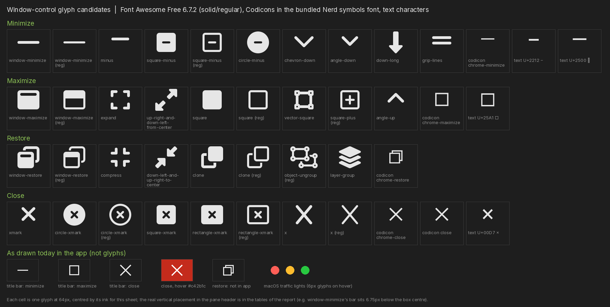

# REPORT — Pane header icons after the Font Awesome Free switch: the small close X and the high Stash briefcase

**Date:** 2026-10-11
**Author:** Maricon@charlie
**Trigger:** Operator report — "with the fontawesome free migration, we got some quirks in placement. On the agent panes, the X should be made larger, and should turn to our standard windows close button red when hovering over it. Also, the briefcase appears offset relative to the other icons, like it is too high. Can you check the structure?"
**Extended:** 2026-10-12 — §8 adds the full spectrum of options for the window control icons (minimize, maximize/restore, close), on request.
**Status:** proposed — analysis only; this report changes no code. §5 is the proposal; flip this line to `implemented` when it lands.

## 1. Summary

- **Both quirks come from the switch to Font Awesome Free (#4665), and from nothing else.** The header's layout is the same for every icon; only two glyphs changed in a way you can see.
  - The close X is `xmark`, which Free draws **29% smaller** than the Pro `xmark-large` it replaced (11.25px against 15.75px of ink at the header's 18px).
  - The Stash briefcase is Free's `suitcase`. It is 6% shorter than the Pro `backpack` it replaced and **its visual centre sits 0.56px above the line** the other icons share. Its top edge is 1.1px higher than the maximize icon beside it.
- **The red hover needs no new mechanism, but one trap.** The close button has no hover style except an opacity change, and `IconButton` writes `color: inherit` inline, which beats a hover rule on the button. The glyph colour has to be set on the `<i>` inside it (§4.2).
- **The close button is shared by every pane.** Changing it changes terminals, editors and the rest as well as agent panes. That is a decision (§6, D1).
- **No other icon moved.** All 166 solid icons the app uses under an unchanged name have the same codepoint and exactly the same geometry in Pro and Free (largest difference 0.00px). Of the nine names that had to be swapped, two matter in headers (the X and the suitcase); the rest are watch items (§4.4).

- **§8 (added later) lays out every way to draw the window controls**: seven icon sources, the glyph candidates for each control with measured size and placement, the states, and five ready-made "kits" to choose between.

Not measured by eye: the operator asked for dev apps on this machine to be wound down, so I did not render the header. Every number comes from the shipped font files and the stylesheets. §7 says how to confirm on screen.

## 2. How the header is built

Every pane, agent panes included, draws its header with `BlockFrame_Header` (`frontend/app/block/blockframe.tsx`). The agent pane's chrome hoists that header out of the block, but it is the same component. Its right-hand cluster is `EndIcons`, inside `div.block-frame-end-icons`:

| Slot | Source | Component | Icon (now) |
|---|---|---|---|
| Stash (agent panes only) | `viewModel.endIconButtons`, set in `agent-model.ts` | `ToggleIconButton` | `suitcase` |
| separator | `div.block-frame-btn-separator` | | |
| Minimize (more than one pane) | `OptMinimizeButton` | `IconButton` | `window-minimize` |
| Maximize / restore | `OptMagnifyButton` | `IconButton` | `window-maximize` / `window-restore` |
| Close | `closeDecl` in `EndIcons` | `IconButton`, class `block-frame-default-close` | `xmark` |

Each slot is one `<button class="wave-iconbutton">` holding one `<i class="fa fa-solid fa-<name> fa-fw">` (`makeIconClass` in `frontend/util/util.ts`; the icon string is the same path for every slot).

The rules that place them:

- `.block-frame-end-icons .wave-iconbutton` (`frontend/app/mixins.scss`): width 26px, `font-size: 18px`, padding 4px 6px, centred both ways. Minimize and maximize override the padding to 0.
- `.fa-solid` (Font Awesome): `line-height: 1`. `.fa-fw`: `width: 1.25em; text-align: center`.
- The header is `--header-height: 33px` with 4px vertical padding (`--space-1`), so the cluster is 25px tall.

So **every icon sits in an 18px-tall, line-height-1 box, centred in its button.** A glyph that looks off is a glyph whose drawing is off-centre in that box. Nothing in the structure differs between the Stash button and its neighbours.

The font swap changed no metrics. Pro and Free solid both have 512 units per em, ascent 459 and descent 75, so the box and baseline are the same.

## 3. What the switch changed

#4665 replaced the Pro fonts with Free and had to rename the icons Free doesn't have. Relevant lines of its description: `xmark-large -> xmark`, `backpack -> suitcase`. `public/fontawesome/css/pro-icon-aliases.css` also maps the old names (`.fa-xmark-large` to `f00d`, `.fa-backpack` to `f0f2`), so a saved config or widget that still says `backpack` shows the suitcase.

## 4. Findings

Measured with fontTools on `fa-solid-900.woff2`, now (Free 6.7.2) and from git history (`951c80f00^`, Pro). Sizes are ink at the header's 18px; "centre" is the glyph's vertical centre against the middle of the 18px box (negative = high).

### 4.1 The close X is 29% smaller

| | glyph | ink (w × h) | centre |
|---|---|---|---|
| before | Pro `xmark-large` (U+E59B) | 15.75 × 15.75px | 0.00 |
| now | Free `xmark` (U+F00D) | 11.25 × 11.25px | 0.00 |

Free has no `xmark-large`. For comparison, `window-maximize` beside it is 18 × 15.75px, so the X now looks small against its neighbours, not only against its old self. Its centre is fine; the fix is size only. To get the old 15.75px of ink back, the glyph needs `font-size` ≈ 25px (11.25 × 25/18 = 15.6px).

### 4.2 The close button has no hover state to speak of, and a colour trap

`block-frame-default-close` has no stylesheet rule. All the button does on hover is go from `opacity: .85` to `1` (`.wave-iconbutton:hover`). The standard Windows close button, defined once in `frontend/app/window/window-controls.win32.scss` (and reused on Linux, whose controls re-export it):

- hover: background `#c42b1c`, glyph white;
- pressed: background `#b7201b`, glyph white;
- the file carries a `stylelint-disable color-no-hex` for exactly these two OS colours.

The trap: `IconButton` renders `style={{ color: props.decl.iconColor ?? "inherit" }}`. An inline style always beats a class rule, so a `:hover { color: #fff }` on the button never applies. (`ToggleIconButton` documents the same problem in a comment and avoids the inline default.) The inline value is needed, since a bare `<button>` doesn't inherit colour. The workaround is to put the white on the `<i>` (`.block-frame-default-close:hover i`), which inherits from the button unless it has a colour of its own. No change to `IconButton` is needed. A background has no such problem: nothing sets it inline.

### 4.3 The Stash briefcase sits high

| | glyph | ink (w × h) | top | bottom | centre |
|---|---|---|---|---|---|
| before | Pro `backpack` (U+F5D4) | 15.75 × 18.00 | 0.00 | 18.00 | 0.00 |
| now | Free `suitcase` (U+F0F2) | 18.00 × 16.88 | 0.00 | 16.88 | **−0.56** |
| neighbour | `window-maximize` | 18.00 × 15.75 | 1.12 | 16.88 | 0.00 |
| neighbour | `xmark` | 11.25 × 11.25 | 3.38 | 14.62 | 0.00 |

The suitcase glyph spans y −32…448 of 512, where most Free solid icons span −64…448 (or 0…384 and so on, but centred). It starts at the top of the box and ends 1.1px short of the bottom, so its centre is 0.56px above the line the other icons share. Next to `window-maximize` it shares the bottom edge but reaches 1.1px higher. That is what reads as "too high". `briefcase` (U+F0B1) has exactly the same drawing, so renaming to it would change nothing.

Be honest about the size: 0.56px at 100% zoom is small, and the case's handle puts more of the visual weight low. I'd expect it to be noticeable beside the centred icons and the thin minimize bar, as reported, but the on-screen confirmation in §7 is worth doing.

Candidates that sit on the line, from the same font (centre 0.00 for all):

| icon | ink (w × h) | top → bottom | note |
|---|---|---|---|
| `toolbox` | 18.00 × 15.75 | 1.12 → 16.88 | same vertical extent as `window-maximize`; reads as "stash/gear" |
| `box-archive` | 18.00 × 15.75 | 1.12 → 16.88 | same extent; reads as "archive" |
| `bag-shopping` | 15.75 × 18.00 | 0.00 → 18.00 | full height; shopping connotation |
| `suitcase-rolling` | 13.50 × 18.00 | 0.00 → 18.00 | narrow |
| `vault` | 20.25 × 18.00 | 0.00 → 18.00 | taken: the global Armory pane uses it, and `REPORT_ARMORY_STASH_NAMING_2026_07_27.md` chose a different icon for Stash on purpose |

### 4.4 Everything else

- **166 of 166** solid icons used under an unchanged name are identical in Pro and Free (same codepoint, same drawing, 0.00px difference).
- The nine substituted names, old → new, at 18px:

| old Pro → new Free | height × width, old | new | size change | centre change |
|---|---|---|---|---|
| `xmark-large` → `xmark` | 15.8 × 15.8 | 11.2 × 11.2 | **−29%** | 0.00 |
| `backpack` → `suitcase` | 18.0 × 15.8 | 16.9 × 18.0 | −6% tall, +14% wide | **−0.56** |
| `bee` → `people-group` | 18.0 × 20.2 | 15.8 × 22.5 | −12% tall, +11% wide | 0.00 |
| `lobster` → `shrimp` | 18.0 × 18.0 | 15.8 × 18.0 | −12% tall | 0.00 |
| `square-terminal` → `terminal` | 15.8 × 15.8 | 15.8 × 20.2 | +28% wide | 0.00 |
| `snake` → `code` | 17.4 × 18.0 | 18.0 × 22.5 | +25% wide | −0.30 |
| `sparkles` → `wand-magic-sparkles` | 18.0 × 18.0 | 18.0 × 19.1 | +6% wide | 0.00 |
| `table-rows` → `table-list`, `browser` → `window-maximize` | | | none | 0.00 |

Only the first two show in the pane headers. The wider ones (`terminal`, `code`, `people-group`) are watch items: any slot sized for the old glyph, rather than for `fa-fw`'s 22.5px, could clip them. I didn't find such a slot; I didn't render them either.

## 5. Proposed changes (not made)

### 5.1 Close X: bigger, and red on hover

CSS only, next to the end-icon rules in `frontend/app/mixins.scss` (the `.block-frame-end-icons` block), with the colours as tokens:

```scss
.block-frame-end-icons .block-frame-default-close {
    border-radius: 3px;                       // a small radius for the red tile (the toggle's grey hover tile has none)

    // Free has no xmark-large. 25px of font makes the X 15.6px, as the Pro glyph was.
    i { font-size: 25px; width: 1em; }        // 1em, not fa-fw's 1.25em (31px > the 26px button)

    &:hover { background: var(--window-close-hover-bg); }
    &:hover i { color: var(--window-close-fg); }   // on the <i>: the button's inline colour beats a button rule (§4.2)
    &:active { background: var(--window-close-press-bg); }
    &:active i { color: var(--window-close-fg); }
}
```

- **Tokens.** Add `--window-close-hover-bg: #c42b1c`, `--window-close-press-bg: #b7201b` and `--window-close-fg: #fff` to `frontend/app/theme.scss` (it already holds the app's raw colours), and point `window-controls.win32.scss` at them. The two files then share one definition of "the standard close red" instead of two copies of the hex values. This is the DRY version; the minimal version is to copy the hex into the new rule under a `stylelint-disable` as the Windows file does.
- **Fit.** The cluster is 25px tall, so a 25px glyph box uses it exactly with no slack. If that looks tight on screen, 22px (13.8px of ink, 87% of the old X) or `transform: scale(1.4)` on the `<i>` (no layout change) are the fallbacks.
- **Shape of the red.** The existing hover for toggle buttons is an inset tile (26 × 25px, 4px in from the header's edge). The proposal keeps that. The real Windows close is full-bleed (46px wide, the whole title bar height, square against the corner); doing that in a pane would mean changing the shared header padding and rounding the red to the pane's top-right radius, which is a bigger change.

### 5.2 Briefcase: pick an icon that sits on the line

**Recommended:** change `icon: "suitcase"` to `icon: "toolbox"` in `frontend/app/view/agent/agent-model.ts`. It has the same vertical extent as the maximize icon next to it (1.12 → 16.88px, centred), so it lines up exactly, and it stays distinct from the Armory's `vault`. If you'd rather keep a briefcase, the fallback is to nudge the glyph down 0.5px with CSS for that one icon; I'd avoid it, since it adds a special case, and a half-pixel offset renders differently at fractional zoom levels.

`box-archive` is the other icon that lines up, if "toolbox" reads wrongly for Stash.

### 5.3 What not to do

- Don't rename to `briefcase`: identical drawing.
- Don't change `makeIconClass`, `IconButton` or the header mixin for either fix: nothing in the structure is wrong.
- Don't change the aliases: they keep old saved names rendering.

## 6. Decisions for the owner

1. **D1: scope of the bigger red X.** The close button is shared, so the change lands on every pane (terminal, editor, browser, agent and so on). Proposed: all panes, so the headers stay consistent. If you want agent panes only, the rule needs a scope (the agent header has its own class) and the other panes keep the small grey X.
2. **D2: the red tile.** Inset tile like the other hover states (proposed), or a full-bleed Windows-style block.
3. **D3: the Stash icon.** `toolbox` (proposed), `box-archive`, or keep the suitcase with a nudge.
4. **D4: the tokens.** Move the two OS reds into `theme.scss` and share them with the window controls (proposed), or copy them locally.

## 7. How to confirm on screen

1. In a dev build, open an agent pane and a terminal pane, and screenshot the header cluster at 100%, 125% and 150% zoom.
2. Measure the ink of the X (expect ≈ 15–16px after the change, 11px now) and the vertical extent of the Stash icon against `window-maximize` (top and bottom edges should match when it's a `toolbox`).
3. Hover the X: the red tile and white glyph. Press it: the darker red.
4. Check Windows too, since the red is a Windows cue and font rendering differs there.

## 8. Extension: the full spectrum of options for the window control icons

Requested 2026-10-12. "Window controls" here means **minimize, maximize/restore and close**, wherever the app draws them, plus (since the Stash button sits in the same cluster) a pointer to §4.3. Everything in this section is analysis: no code changed, and nothing was rendered in the running app. The specimen sheet below is drawn from the shipped font files, not from a browser.



### 8.1 What the app draws today (the inventory)

| Surface | Controls | How they are drawn | Size and weight | Hover / press | Source |
|---|---|---|---|---|---|
| **Title bar, Windows and Linux** (Linux re-exports the Windows set) | minimize, maximize, close | three inline SVGs, `currentColor`, copied from the Windows 11 caption look | 10 × 10 viewBox, 1px stroke, in 46px-wide full-height tiles | neutral overlay (13% / 9% white on dark); close: solid `#c42b1c` / `#b7201b` with a white glyph | `frontend/app/window/window-controls.win32.tsx`, `.scss` |
| **Title bar, macOS** | close, minimize, zoom | coloured circles (traffic lights) with a 6px inline SVG glyph (×, –, expand arrows) shown on hover | 6 × 6 glyph | glyph appears | `window-controls.darwin.tsx` |
| **Pane header** (every pane) | minimize, maximize/restore, close (+ Stash on agent panes) | Font Awesome Free solid, as `icon: "<name>"` strings through `makeIconClass` | 18px font-size; ink 18 × 2.25 (minimize bar), 18 × 15.75 / 18 × 18 (maximize / restore), 11.25 × 11.25 (close) | opacity .85 → 1 only (§4.2) | `frontend/app/block/blockframe.tsx` |
| **Floating-pane header** | maximize (fixed, never changes), close | same as the pane header | same | same | `FloatingMaximizeButton` in `blockframe.tsx` |
| **Window tab** (the top tab strip) | close | VS Code's `close` codicon, pasted in as an inline SVG | 16 × 16 | `Button` ghost style | `frontend/app/tab/tab.tsx` |
| **Pane tab** (the pill strip inside a pane) | close | the text character `×` in a 16px button | font-dependent | opacity, shown on hover | `PaneTabStrip.tsx` |
| **Other close buttons** | search bars, lightbox, attachment tiles, swarm, command palette | `fa-xmark` (about a dozen places), and the text `×` / `&times;` in three search or filter inputs and two failure chips | mixed | mixed | `grep xmark`, `grep &times;` in `frontend/app` |

Behaviours to know before choosing:

- **State is deliberately thin.** The pane header's maximize swaps `window-maximize` ↔ `window-restore`, and its minimize swaps `window-minimize` → `window-restore` while minimized. The title bar's maximize and the floating pane's maximize are *fixed* buttons whose icon never changes; the floating pane's code says why (`FloatingMaximizeButton`: one click toggles, and a mirrored icon state can drift from the reducer). The title bar has no such comment; I am assuming the same reason.
- **Five different closes already coexist:** Free `xmark` (solid, 11px of ink in a header), the Fluent-style 1px ×, the codicon × (tab), the text `×` (pane tab), and macOS's circle. They differ in weight, size and shape; the §5 fix would make a sixth look if it only touches the pane header, so it is worth choosing a direction for all of them.
- **The `icon:` string reaches more than the header.** `makeIconClass` accepts `name`, `solid@name`, `regular@name`, `brands@name` and `custom@name`. Widget configs and saved layouts use the same strings. **`regular@window-minimize` works today with no code change**; a new family (codicons, inline SVG) does not.

### 8.2 The dimensions of choice

Every option below is a point on these axes. They can be chosen independently.

| Axis | Choices |
|---|---|
| **Family** (where the shape comes from) | A Font Awesome Free solid · B Font Awesome Free regular (outline) · C codicons in the bundled Nerd symbols font · D inline SVG (Fluent or codicon paths, or our own) · E the custom icon kit (`custom@`) · F text characters · G CSS-drawn shapes |
| **Weight** | heavy fills (FA solid, 2.25px bars) · outline (FA regular, 1.7px) · hairline (Fluent and codicons, 1px) |
| **Vocabulary** | window metaphor (`window-*`, two squares for restore) · generic symbols (×, −, □) · icons inside a container (circle, square, rectangle) |
| **Size** | the 18px font box (§2) fits ink up to 18px; the X today is 11px |
| **State** | maximize ↔ restore swap · fixed button · disabled · pressed · "danger" (red) on close |
| **Scope** | pane headers only · plus the tab and pane-tab closes · plus every other `xmark` · plus the title bar |
| **Platform** | one look everywhere (today on Windows and Linux) · each OS's own convention |

### 8.3 Candidates, per control, with their measurements

All sizes and placements are at the header's 18px font-size, measured with fontTools exactly as in the Appendix. **Ink** is the drawn width × height. **Centre** is the vertical centre against the middle of the 18px box (negative = high, positive = low); anything beyond ±0.3px reads as misaligned beside its neighbours.

**Minimize**

| Option | Family | Ink | Centre | Notes |
|---|---|---|---|---|
| `window-minimize` (today) | A solid | 18.00 × 2.25 | **+6.75** | the bar sits at the *bottom* of the box (y 14.6 → 16.9), the Windows "minimize" convention; the other icons are centred |
| `window-minimize` | B regular | 18.00 × 1.69 | **+7.03** | thinner bar, same low placement |
| `minus` | A solid | 14.62 × 2.25 | 0.00 | the same weight as today's bar, **centred** |
| `square-minus` | A solid / B regular | 15.75 × 15.75 | 0.00 | container; reads as "collapse" |
| `circle-minus` | A solid | 18.00 × 18.00 | 0.00 | container |
| `chevron-down`, `angle-down` | A solid | 15.75 × 9.00, 13.50 × 7.88 | +1.12, +0.56 | the pair the header used before `window-minimize`; a comment in `blockframe.tsx` says it read as a dropdown toggle |
| `grip-lines`, `down-long` | A solid | 15.75 × 6.75, 11.26 × 18.00 | 0.00 | not window metaphors |
| codicon `chrome-minimize` | C | 10.84 × 1.00 | 0.00 | hairline, centred; needs `font-size` ≈ 26px for a 15.7px bar |
| Fluent SVG (title bar today) | D | 10 × 1 stroke | n/a (placed by the box) | exists |
| text `−` (U+2212), `─` (U+2500) | F | font-dependent | | present in Inter and Hack |

**Maximize**

| Option | Family | Ink | Centre | Notes |
|---|---|---|---|---|
| `window-maximize` (today) | A solid | 18.00 × 15.75 | 0.00 | a filled window with a title bar |
| `window-maximize` | B regular | 18.00 × 15.75 | 0.00 | outline version |
| `square`, `square-full` | A solid / B regular | 15.75², 18.00² | 0.00 | the plain Windows square, `regular` is the outline |
| `expand`, `maximize` | A solid | 15.75 × 15.75 | 0.00 | four corners (`maximize` is an alias of the same drawing) |
| `up-right-and-down-left-from-center` | A solid | 18.00 × 18.00 | 0.00 | diagonal arrows; the macOS "zoom" idea |
| `vector-square` | A solid | 15.75 × 15.75 | 0.00 | selection-box look; wrong metaphor |
| codicon `chrome-maximize` | C | 10.84 × 10.85 | 0.00 | hairline square |
| Fluent SVG | D | 10 × 10, 1px | | exists |

**Restore**

| Option | Family | Ink | Centre | Notes |
|---|---|---|---|---|
| `window-restore` (today) | A solid | 18.00 × **18.00** | 0.00 | two stacked windows; **2.25px taller than `window-maximize`**, so the icon grows when it swaps (a visible jump at 18px) |
| `window-restore` | B regular | 18.00 × 18.00 | 0.00 | outline |
| `clone` | A solid / B regular | 18.00 × 18.00 | 0.00 | two overlapping squares, the Windows restore drawing |
| `compress`, `down-left-and-up-right-to-center` | A solid | 15.75², 18.00² | 0.00 | arrows pointing in |
| `object-ungroup`, `layer-group` | B regular / A solid | 22.50 × 18.00, 18.00 × 18.00 | 0.00 | wrong metaphor, and 22.5px is wider than the 18px box |
| codicon `chrome-restore` | C | 10.84 × 10.79 | 0.00 | hairline, two squares |
| Fluent SVG | D | **not in the app** | | the title bar has no restore glyph (a fixed button); one would be two offset 10px squares |

**Close**

| Option | Family | Ink | Centre | Notes |
|---|---|---|---|---|
| `xmark` (today) | A solid | **11.25 × 11.25** | 0.00 | `times`, `multiply`, `close`, `remove` are aliases of the same drawing; **no regular version exists** |
| `x` | A solid / B regular | 13.51 × 15.76 | 0.00 | the letter-X shape: tall, not square |
| `circle-xmark` | A solid / B regular | 18.00 × 18.00 | 0.00 | a container; reads as "dismiss", not "close window" |
| `square-xmark` | A solid | 15.75 × 15.75 | 0.00 | |
| `rectangle-xmark` | A solid / B regular | 18.00 × 15.75 | 0.00 | a window with an ×; matches `window-maximize`'s extent |
| `ban`, `circle-stop`, `power-off` | A solid | 18², 18², 16.88 × 17.44 | 0, 0, −0.28 | other meanings |
| codicon `chrome-close`, `close` | C | 10.84 × 10.85 | 0.00 | hairline ×; the same drawing as the tab's close |
| Fluent SVG | D | 10 × 10, 1px | | exists (title bar); hovers to `#c42b1c` |
| text `×` (U+00D7) | F | font-dependent | | in Inter and Hack. `✕ ✖ ☐ ❐ ⧉` are **not** in the bundled fonts and draw as empty boxes (tofu) without a system fallback; avoid them |

**Stash** (for completeness; §4.3 has its table): `toolbox`, `box-archive` and `folder-closed` all centre at 0.00; `suitcase` / `briefcase` / `suitcase-medical` / `briefcase-medical` all sit at −0.56.

### 8.4 The families, with what each costs

| Family | What it is here | Cost to use for the window controls | Strengths | Weaknesses |
|---|---|---|---|---|
| **A. FA Free solid** (today) | `fa-solid-900.woff2`, 1,976 codepoints | none: change a string | one font, themeable colour, already loaded, 18px box metrics known | heavy; no `xmark-large`; `window-minimize` sits low |
| **B. FA Free regular** | `fa-regular-400.woff2`, 436 codepoints | a prefix on the string (`regular@…`) | outline weight closer to the title bar; works with no code change | small set: `window-minimize/maximize/restore`, `circle-xmark`, `rectangle-xmark`, `square-minus`, `clone`, `x`, `square`. **No regular `xmark`, `minus`, `expand` or chevrons.** |
| **C. Codicons** (VS Code's set) | 439 codicon glyphs in `hacknerdmono-symbols.woff2` (U+EA60…), registered as the `Hack` family at app init (`fontutil.ts`, range `U+E000–F8FF`); includes the four `chrome-*` window glyphs | a new branch in `makeIconClass` (a prefix such as `cod@`) or a small component; sizing to about 26px for 15.7px of ink | the actual shapes VS Code and Windows use; the app already uses the `close` codicon for tab-close, so this would unify with it; no new font file | hairline weight can look weak beside FA solid in the same cluster; the face is registered and loaded at app init (`loadFonts`) but asynchronously, so a very first paint may use a fallback; CC BY 4.0 attribution, already recorded in `licenses/bundled/fonts-hack-nerd-font.txt` |
| **D. Inline SVG** | the title bar's three Fluent glyphs, the codicon `close` path, macOS's three | write or export a small component per glyph; not reachable through `icon:` strings | pixel-exact, any stroke weight, `currentColor`, no font to load, can add the missing restore glyph | one more thing to keep consistent; widget configs cannot name them |
| **E. Custom kit** (`custom@`) | `custom-icons.woff2`: `case-sensitive`, `regex`, `whole-word`, two logo glyphs | rebuild `custom-icons.woff2` with new glyphs (I did not look for its source) | bespoke shapes at our own metrics; reachable via `custom@name` | a font build step and a place to keep the sources |
| **F. Text characters** | `×`, `−`, `□` | one character | no assets | depends on the font that happens to supply it; weight and size vary by OS; only `× − ─ □` are covered by the bundled fonts |
| **G. CSS-drawn** | borders, `::before` / `::after`, gradients | write the rules | crisp at any zoom, themeable, can animate × ↔ − | hand-tuned per size; not an icon string |
| **Native decorations** (not recommended) | let the OS draw its own title bar | structural: the tab strip lives in the title bar today | exactly platform-correct | loses tabs-in-title-bar and the custom hover design, and behaves differently per Linux desktop |

### 8.5 States and interaction

Independent of the family:

| State | Today | Options |
|---|---|---|
| **Maximize ↔ restore** | pane header swaps the glyph; title bar and floating pane are fixed | keep (the floating pane's code documents stateless buttons as a decision); or give the title bar a restore glyph from the same family. If a `window-*` pair is kept, remember `window-restore` is 2.25px taller than `window-maximize` (§8.3) |
| **Minimize** | pane header: `window-minimize`, and `window-restore` while minimized | keep; or switch to a centred `minus` so the bar lines up with its neighbours (§8.3) |
| **Close hover** | opacity only | red tile (inset, §5.1) · full-bleed red as the title bar · red glyph only (no tile) · a round tile (the GNOME or macOS idiom) |
| **Pressed** | none | the darker `#b7201b` as in the title bar |
| **Disabled** | `disabled` is supported on the button decl (the docked maximize uses it) | opacity .4, no hover |

The colour trap of §4.2 applies to every family: `IconButton` writes `color: inherit` inline, so any hover colour must go on the glyph or the background, not the button's `color`.

### 8.6 Five kits: combinations that hang together

| Kit | Minimize | Maximize / restore | Close | Changes | Result |
|---|---|---|---|---|---|
| **1. Minimal fix** (the §5 proposal) | `window-minimize` | `window-maximize` / `window-restore` | `xmark` at 25px, red tile on hover | CSS only | heavy glyphs stay; the X grows. Smallest change; the pane header still differs from the title bar |
| **2. FA outline** | `regular@window-minimize` | `regular@window-maximize` / `regular@window-restore` | `regular@circle-xmark` or `regular@rectangle-xmark` | three strings | lighter, one family, no new code. The close becomes a container, not a bare ×; Free has no regular `xmark` |
| **3. Centred FA solid** | `minus` | `window-maximize` / `clone` | `xmark` at 25px | strings and the CSS of kit 1 | every glyph is centred on the same line; `clone` (18.00² and a copy-style look) swaps with a 15.75px-tall maximize, so the jump remains |
| **4. Windows caption everywhere** | Fluent `minimize` SVG | Fluent `maximize` / a new `restore` SVG | Fluent `close` SVG on the red tile | export the three title-bar glyphs as shared components, add a restore glyph | the pane header looks like the title bar and like Windows; hairline glyphs sit beside heavy FA icons (Stash, widgets), which may look light |
| **5. Codicons** | `chrome-minimize` | `chrome-maximize` / `chrome-restore` | `chrome-close` | one `makeIconClass` branch (or a component), plus sizing near 26px | the glyph set VS Code uses; consistent with the tab's close; no SVG files; hairline weight as in kit 4; font load timing to check |

Cross-cutting (any kit): bring the **tab close and pane-tab close** (§8.1) into the same family, so there is one close shape in the app, not five.

### 8.7 Recommendation

- **Now:** kit 1 with D1–D4 of §6. It answers the report as written (a larger X, red on hover), costs a few lines of CSS, and does not pick a direction for the whole app.
- **If the aim is one consistent set across the title bar, headers and tabs:** kit 4 (reuse the title bar's three glyphs plus a restore) or kit 5 (codicons). Kit 4 needs no new assets and matches what Windows users see in the title bar; kit 5 reaches the same look through the font that the tab close already borrows from. Both are hairline, so I would try them next to the Stash icon on screen before committing: the §7 steps apply.
- **Not recommended:** text characters beyond `× −`, native decorations, and a regular-weight set that leaves the close without a bare ×.

### 8.8 Decisions for the owner (extends §6)

5. **D5: one close for the app, or only the header?** Decide whether kit 1's X also replaces the tab, pane-tab and other `xmark` closes (§8.1).
6. **D6: weight.** Keep the heavy FA solid look in headers, or move headers to the hairline look of the title bar (kits 4 and 5).
7. **D7: the title bar's maximize.** Leave it fixed (as the floating pane's code documents for its own maximize) or give it a restore glyph.
8. **D8: Linux.** Keep the Windows look on Linux, or give GNOME and KDE their own convention (more work, and it needs a desktop check).

### 8.9 What this section does not cover

- **Nothing was rendered in the running app.** The specimen is drawn from the font files with Pillow; the browser's text rendering, hinting and fractional zoom will differ, so the placements in §8.3 are the geometry, not a screenshot.
- **Codicons in the header were not tried.** I measured the glyphs and read how the font is registered, but did not check that the `Hack` family, which loads asynchronously at app init, has arrived before the first header paints.
- **GNOME and KDE conventions** are described from knowledge of those desktops, not measured here.
- **The custom kit's source** (for family E) was not located.
- Pro-only options (Sharp, Duotone, Thin, Light) are not available: the app ships the Free fonts only.

## Appendix: how this was measured

fontTools on the shipped `public/fontawesome/webfonts/fa-solid-900.woff2` (Free 6.7.2) and, for the old glyphs, on `fa-solid-900.woff2` from `git show 951c80f00^:public/fontawesome/webfonts/fa-solid-900.woff2` (Pro). For each glyph, the bounds come from `BoundsPen`; with `line-height: 1` the baseline sits `ascent + (unitsPerEm − (ascent + descent)) / 2` below the top of the box, so

```
top    = (baseline − yMax) / unitsPerEm × fontSize
bottom = (baseline − yMin) / unitsPerEm × fontSize
centre = (top + bottom) / 2 − fontSize / 2        # negative = above the line
```

Codepoints come from `fontawesome.min.css` and `pro-icon-aliases.css` (Free) and from the old `fontawesome.min.css`, which stores the glyph as a raw private-use character (`--fa:"<char>"`). Icon names for the 166-icon scan are every `fa-<name>`, `icon: "<name>"` and `icon="<name>"` in the frontend and the server's widget config; regular, brands and custom-kit icons are not covered.
