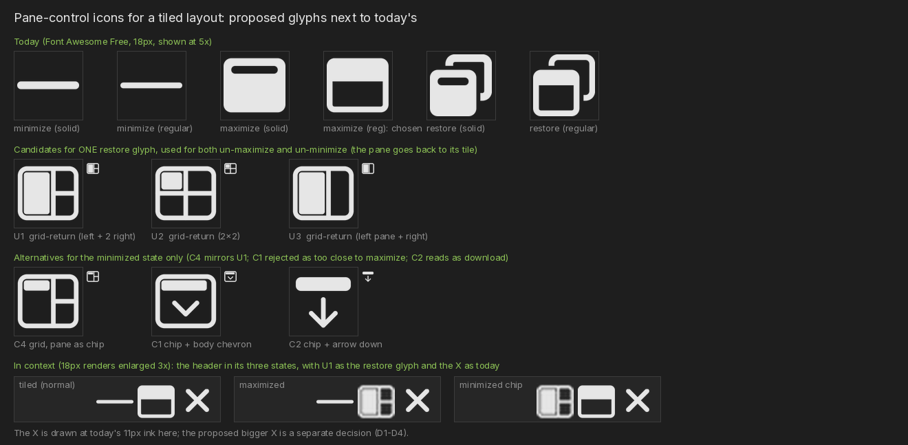
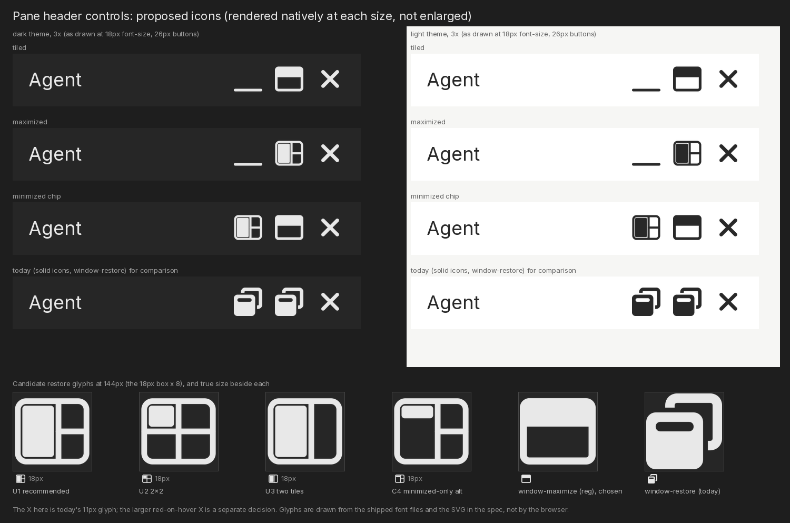

# Spec — Pane controls: the outline maximize icon, a restore icon for a tiled layout, and minimizing a maximized pane directly

**Date:** 2026-10-12
**Author:** Maricon@charlie
**Type:** Spec (three small, separable changes)
**Status:** implemented (#4838)
**Decisions applied:** changes A, B and C, with D1 = yes, D2 = one glyph, D3 = restore to the tile, D4 = no title change; D5 is left out of scope. The operator picked the three header states of the preview; the close X is unchanged.
**Requested by:** the operator: *"i like the windows maximize (reg) for the maximize button. Also, the restore button that appears when a pane is minimized is not really accurate since agentmux has tiled windows, no overlaid windows. can you design an icon that makes more sense? Finally, we want to be able to minimize a maximized pane directly (without having to first restore then minimize) so it would need to remember its minimize position when maximized."*
**Related:** `docs/reports/REPORT_PANE_HEADER_ICONS_FA_FREE_2026_10_11.md` (§8 has the icon options this builds on), `SPEC_LAYOUT_MINIMIZE_LOCKED_STATE_REDESIGN_2026_07_16.md` §8 (minimize is a display mode), `SPEC_MAXIMIZE_ZOOM_ARCHITECTURE_2026-05-21.md` (magnify).





## 1. Summary

| # | Change | Size |
|---|---|---|
| A | The pane header's **maximize** button uses Font Awesome Free's *regular* `window-maximize` (the outline window) instead of the solid one. | one string, plus the same icon where the maximize action is shown elsewhere |
| B | A new **restore** glyph for a tiled layout replaces `window-restore` (two overlapping windows) on the two buttons that return a pane to its tile: the minimized pane's *Restore*, and the maximized pane's *Restore*. | one small inline-SVG component, two call sites |
| C | The **minimize button also shows while a pane is maximized**, and minimizing a maximized pane ends the maximize and collapses the pane to its header chip in its own slot, in one step. | one condition in the header and a few lines in `minimizeNodeToggle`; no new stored state |

Nothing here changes the layout tree's shape, its persisted format or the backend. A and B are presentation; C is a rule about two existing flags.

## 2. How it works today

Facts, with the code that holds them (`frontend/`).

- **The header's buttons.** `BlockFrame_Header` → `EndIcons` (`app/block/blockframe.tsx`):
  - `OptMinimizeButton`: icon `window-minimize`, or `window-restore` while the pane is minimized (title "Minimize" / "Restore").
  - `OptMagnifyButton`: icon `window-maximize`, or `window-restore` while the pane is magnified (title "Maximize" / "Restore").
  - Both icons are strings given to `IconButton`; they render Font Awesome Free *solid* (`makeIconClass` with no style prefix). `IconButtonDecl.icon` also accepts a JSX element (`app/element/iconbutton.tsx` renders it as is), so a custom glyph needs no change to `IconButton`.
- **The minimize button is hidden while a pane is maximized.** It sits behind `<Show when={!ephemeral() && !magnified() && numLeafs() > 1 && canMinimize()}>`. This is the only reason a maximized pane cannot be minimized: the layout code has no rule against it.
- **Maximize ("magnify") is a layer over the tree, not a change to it.** `magnifiedNodeId` on the tab's tree state (`layout/lib/layoutTree.ts` `magnifyNodeToggle`) names the pane that `MagnifiedPaneOverlay` draws over the layout (at `magnifiedNodeSize`, default 0.8); every tile node is hidden while it is active, and drag is disabled (`TileLayout.core.tsx`). No node is moved, resized or re-parented, so **the pane's slot in the tree is exactly where it was**.
- **Minimize is a display mode.** A minimized pane is a leaf with `minimized: true` and nothing else; its stored `size` is never touched, and the renderer derives a header chip for it from its slot (`layoutMinimize.ts`, `layoutGeometry.ts`). Restore is clearing the flag. `minimizeNodeToggle` refuses to minimize the last expanded pane, and `NodeModel.canMinimize` hides the button in that case.
- **The two flags are independent today.** Nothing in `magnifyNodeToggle` looks at `minimized`, and nothing in `minimizeNodeToggle` looks at `magnifiedNodeId`, so a pane can be both (reachable today by maximizing a minimized chip).
- **Torn-off floating panes** have their own fixed maximize button (`FloatingMaximizeButton`, icon `window-maximize`, never swapped) and no minimize button (`numLeafs() > 1` is false there). They are real OS windows.
- **Where `window-restore` means something else.** The ☰ menu's *New Window* entry (`app/window/hamburger-menu.tsx`) and the browser pane's pop-out controls use `window-restore` to mean "another window", which is accurate and stays.

## 3. Change A: the outline maximize icon

**Decision (operator):** the maximize button uses `regular@window-maximize`.

- `OptMagnifyButton`: `props.magnified ? <restore glyph, B> : "regular@window-maximize"`.
- `FloatingMaximizeButton`: `icon: "regular@window-maximize"`, to keep every pane header the same.
- The prefix works today: `makeIconClass` accepts `regular@<name>` and renders `fa fa-regular fa-<name>`; the regular font ships in `public/fontawesome/webfonts/fa-regular-400.woff2` and contains `window-maximize`.
- **Size and placement are unchanged.** The regular glyph has the same extent as the solid one at 18px: 18.00 × 15.75px ink, vertical centre 0.00 (measured, report §8.3). Its stroke is about 1.7px (the regular minimize bar measures 1.69px); the solid glyph is a filled window.
- **Other places that show the same action.** For consistency, the quick-tips row (`app/element/quicktips.tsx`, class `fa-window-maximize`) uses the regular style too. The `pane:magnify` command's own icon (`up-right-and-down-left-from-center`) and the OS *window* commands (`window:maximize`, and the title bar's own SVG) are unchanged: they are not the pane header's maximize button.
- **Weight pairing (decision D1).** A solid minimize bar (18 × 2.25px) beside an outline maximize looks uneven. Recommended: `regular@window-minimize` as well (18 × 1.69px; it sits at the bottom of the box, +7.03px, as the solid one does at +6.75px, so the placement is unchanged). The close X and the Stash icon stay as the icon report decides.

## 4. Change B: a restore glyph for a tiled layout

### 4.1 Why `window-restore` is wrong here

`window-restore` draws two windows, one overlapping the other. It means "bring a maximized window back down over the others". AgentMux panes never overlap: they tile. Restoring a pane means *it goes back to its tile in the grid*. Today two different buttons use this glyph (§2), each to mean that.

### 4.2 The design

A **frame split into tiles, with the restored pane's tile filled**: the pane returns to its place in the grid, and its neighbours are drawn as outlines.

Glyph `PaneRestoreGlyph` ("U1" on the sheet above), 18 × 18 box, `currentColor`, **1.36px stroke: 80% of Free regular's roughly 1.7px, at the operator's request** (so its lines are a little lighter than the outline `window-maximize` beside it):

```svg
<svg viewBox="0 0 18 18" width="1em" height="1em" fill="none" stroke="currentColor"
     stroke-width="1.36" stroke-linecap="round" stroke-linejoin="round" aria-hidden="true">
  <rect x="0.85" y="1.83" width="16.3" height="14.34" rx="2"/>
  <path d="M10.5 1.83L10.5 16.17"/>
  <path d="M10.5 9L17.15 9"/>
  <rect x="1.93" y="2.91" width="7.5" height="12.18" rx="0.75" fill="currentColor" stroke="none"/>
</svg>
```

- **Extent.** 17.7 × 15.7px of ink (y 1.15 → 16.85 of the 18px box), centred; the frame was resized with the thinner stroke so the extent is unchanged: the same extent as `window-maximize` (18 × 15.75px), so the header buttons line up.
- **Why this one.** It is unmistakably a layout (a frame with dividers), so it cannot read as an overlapping window. It reads differently from `window-maximize` regular, which is a frame with a filled title bar and no dividers. The left tile is the pane; the two right tiles stand for "the rest of the layout".
- **One glyph for both buttons.** Both restores go to the same place, the pane's normal tile, and today both already share one glyph. Recommended: keep them sharing (decision D2). If the owner wants the minimized state to look different, the alternative is "C4" on the sheet: the same frame with the pane's tile showing only a filled header chip (the pane collapsed in the grid), used for the minimized state only.
- **Rejected on the sheet.** "C1" (a frame with a filled header and a chevron) is too close to `window-maximize`; "C2" (a chip over a down arrow) reads as *download*; the chevron-style minimize the app used before was replaced because it read as a dropdown (a comment in `blockframe.tsx`). "U2" (2×2) and "U3" (two tiles) are acceptable simpler variants of U1 if the owner prefers.

### 4.3 Where it is used

| Place | Today | After |
|---|---|---|
| `OptMinimizeButton`, while minimized | `window-restore` (solid) | `PaneRestoreGlyph` |
| `OptMagnifyButton`, while magnified | `window-restore` (solid) | `PaneRestoreGlyph` |
| ☰ → New Window; browser pane pop-out | `window-restore` | **unchanged** (real separate windows) |

### 4.4 Implementation notes

- New file `frontend/app/element/pane-control-glyphs.tsx` exports `PaneRestoreGlyph(): JSX.Element` (the SVG above). Pass it as the decl's `icon`: `decl.icon = <PaneRestoreGlyph />`. `IconButton` already renders a non-string icon unchanged; its `style={{ color: … ?? "inherit" }}` gives the SVG its colour, so the hover rules of the icon report's §4.2 apply.
- The button already centres its content; the SVG is `display: block` at `1em` (18px), so it sits on the same line as the font icons beside it.
- Titles and `aria-label` stay "Restore" (the button's `title`).
- Why an inline SVG: Free has no tile-style restore (the closest, `table-columns`, `table-cells-large` and `grip`, read as "table" or "grid view"), and the custom icon font needs a font rebuild. An inline component also matches how the title bar's and the tab's glyphs are made.

### 4.5 Tests

- Render test: `PaneRestoreGlyph` returns an `svg` with `viewBox="0 0 18 18"`, `stroke="currentColor"`, no fixed colour.
- Header test: a minimized pane's minimize button and a magnified pane's maximize button render the glyph (no `fa-window-restore` class); a tiled pane's buttons render `fa-window-minimize` and `fa-window-maximize` in the regular style.
- Ink check (a unit test or a one-off script): the glyph's bounding box is within 0.5px of 18 × 15.75 and centred vertically.

## 5. Change C: minimize a maximized pane directly

### 5.1 The behaviour

| Pane state | Minimize button | Maximize button |
|---|---|---|
| tiled | *Minimize*: collapses the pane to its chip (as today) | *Maximize* (`regular@window-maximize`) |
| **maximized** | ***Minimize*: now shown.** Ends the maximize and collapses the pane to its chip in its own slot, in one step | *Restore* (`PaneRestoreGlyph`): ends the maximize (as today) |
| minimized | *Restore* (`PaneRestoreGlyph`): expands it back to its tile (as today) | *Maximize* (as today) |

After **Minimize** on a maximized pane the tab shows the normal tiled layout with that pane as a header chip in the place it occupies in the tree. Every other pane is unchanged and visible again.

### 5.2 "Remember its minimize position": what that needs

It needs **no new stored state**, because maximize never moves a pane. A maximized pane keeps its tile slot in the tree; minimize is a flag on that same leaf; the renderer derives the chip's position (the header strip in its column, or a chip in its row, with the existing slip rules) from the slot. So "the position it would have minimized to" is already the tree position, and minimizing from maximized is the same operation as minimizing from tiled, plus ending the maximize.

The one condition that must hold is that the tree is not edited while the pane is maximized in a way that removes its slot. That is already the case: drag is disabled while a pane is maximized, and closing or moving a pane is handled by the existing paths (`removeLeafEmptiedByMove` already un-magnifies before it deletes a leaf).

### 5.3 Rules

1. **Atomic.** Ending the maximize and setting `minimized` happen in one tree update and one `persistToBackend()` call, so no intermediate state (maximized and minimized, or neither) is ever rendered or persisted.
2. **Same guard as today.** A pane can be minimized only while another pane stays expanded (`canMinimize`, `countExpandedLeaves`). A maximized pane whose neighbours are all minimized has no minimize button, exactly as the last expanded tiled pane has none today.
3. **Restore goes to the tile**, not back to maximized (decision D3). Restoring a minimized pane clears the flag, as today; the pane returns to its tile.
4. **Focus** does what minimizing a tiled pane does today: `minimizeNodeToggle` changes no focus. Ending the maximize here passes `focused: false` to `magnifyNodeToggle` so it does not request focus either; the pane keeps focus as a chip.
5. **A pane is not left both minimized and maximized by this change.** The existing way to reach that state (maximizing a minimized chip) is unchanged by this spec. If a pane is both, the minimize button behaves by its `minimized` state as before (it reads *Restore* and clears the flag).

### 5.4 Implementation

- `OptMinimizeButton`'s condition (`blockframe.tsx`): drop `!magnified()`: `when={!ephemeral() && numLeafs() > 1 && canMinimize()}`.
- `minimizeNodeToggle` (`layout/lib/layoutMinimize.ts`), in the minimize branch, after the last-expanded guard and before setting the flag:
  ```ts
  if (model.magnifiedNodeId === nodeId) {
      // End the maximize through its own reducer so the overlay unmounts and
      // the tree state stays consistent; do not request focus or persist yet.
      model.magnifyNodeToggle(nodeId, /* setState */ false, /* focused */ false);
  }
  node.minimized = true;
  _finishToggle(model, nodeId, true);
  ```
  `_finishToggle` then runs the single `updateTree()`, the layout doctor report and `persistToBackend()`. This is the same pattern `removeLeafEmptiedByMove` already uses to un-magnify as part of a bigger edit. The implementer should check that `magnifyNodeToggle(…, false)` followed by the flag write produces one render and one persisted write, and add the `lastEphemeralNodeId = undefined` line that `magnifyNodeToggle` sets if the overlay animation needs it.
- `NodeModel.canMinimize` needs no change.
- No backend change: `magnifiednodeid` and the leaf's `minimized` flag are both persisted already, and both are written by the one `persistToBackend()`.
- Out of scope, noted: there is no keyboard shortcut for pane minimize today (only `pane:magnify`); a `pane:minimize` command would be a separate addition and would follow the same rule.

### 5.5 Tests

Unit tests next to the layout tests (`layout/lib`):

1. Minimize on the magnified leaf of a three-pane tree: `magnifiedNodeId` becomes undefined, the leaf is in `minimizedNodeIds`, and the tree's structure and every `size` are unchanged.
2. One `persistToBackend` call and one `updateTree` for that action; the persisted tree never has both set or neither.
3. Last-expanded guard: the leaf of a tree whose other leaves are minimized cannot be minimized (no change to the flags).
4. Restore after (1): the leaf is no longer minimized, `magnifiedNodeId` is still undefined, and the tree equals the original.
5. A magnified leaf in a Row parent and one in a Column parent: the derived chip geometry is the same as minimizing the same leaf when tiled.
6. Header: the minimize button renders for a magnified pane when `canMinimize()` is true, and not when it is false.

## 6. Verification on a real build

1. Open a tab with three panes; maximize the middle one. The header shows *Minimize* and *Restore*. Click *Minimize*: the layout returns, the pane is a chip in the middle slot, the others are as before. Click the chip's *Restore*: the pane is back at its original size.
2. Repeat with a row layout and a column layout, and with a pane that has several pane-tabs.
3. Maximize a pane whose neighbours are all minimized: no minimize button.
4. Quit and relaunch after step 1 (pane minimized): the layout and the chip are restored; nothing is maximized.
5. Look at the header at 100%, 125% and 150% zoom, on Windows, macOS and Linux: the three buttons line up; the maximize outline and the tile glyph are crisp.
6. A torn-off floating pane: its maximize button shows the outline icon and nothing else changes.

## 7. Decisions for the owner

| | Question | Recommended |
|---|---|---|
| D1 | Make the minimize button `regular@window-minimize` too, so the two share a weight? | yes |
| D2 | One restore glyph for both restores, or a separate one for the minimized state (U1 and C4 on the sheet)? | one glyph, U1 |
| D3 | After minimizing a maximized pane and then restoring it, does it return to its tile, or to maximized (as an OS window does)? | its tile: the others are on screen when you restore it, and re-maximizing would hide them again |
| D4 | Rename both buttons' titles to "Restore to layout"? | no change (keep "Restore") |
| D5 | Should maximizing a *minimized* chip first restore it, so a pane is never both? | out of scope here; ask if it matters |

## 8. What this spec does not cover

- The close X, the Stash icon and the title bar's controls (the icon report's §5–§8).
- A keyboard command for pane minimize.
- Minimize for torn-off floating panes (they have no minimize button).
- The look of a maximized pane (size, blur) and the chip's own design.
- I did not run the app: the sheet's glyphs are drawn from the font files and the SVG above, not rendered by the browser, and the layout claims in §2 come from reading the code. §5.4's call sequence is the part to confirm first when implementing.
