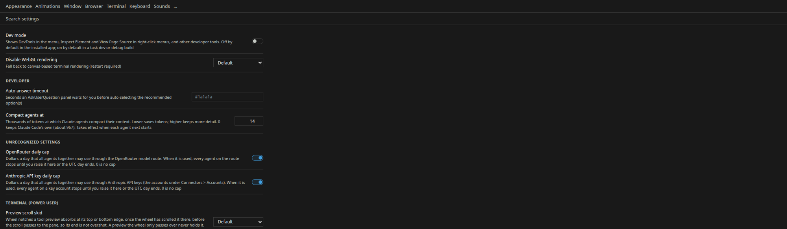
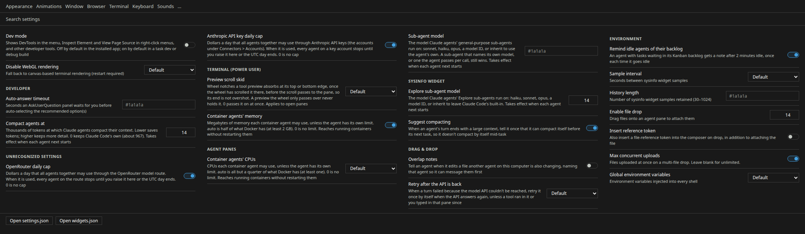
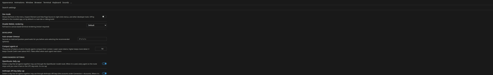
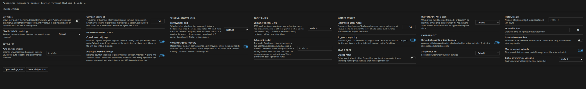
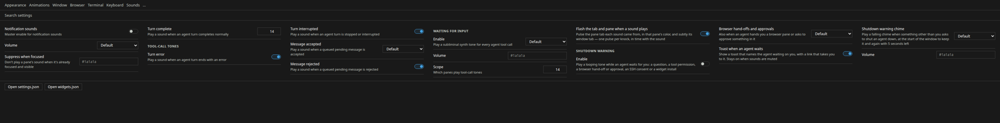
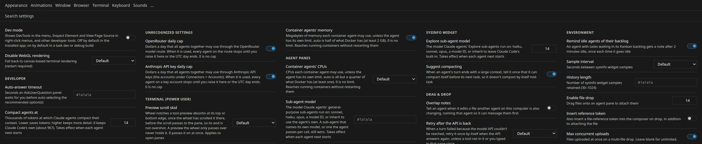
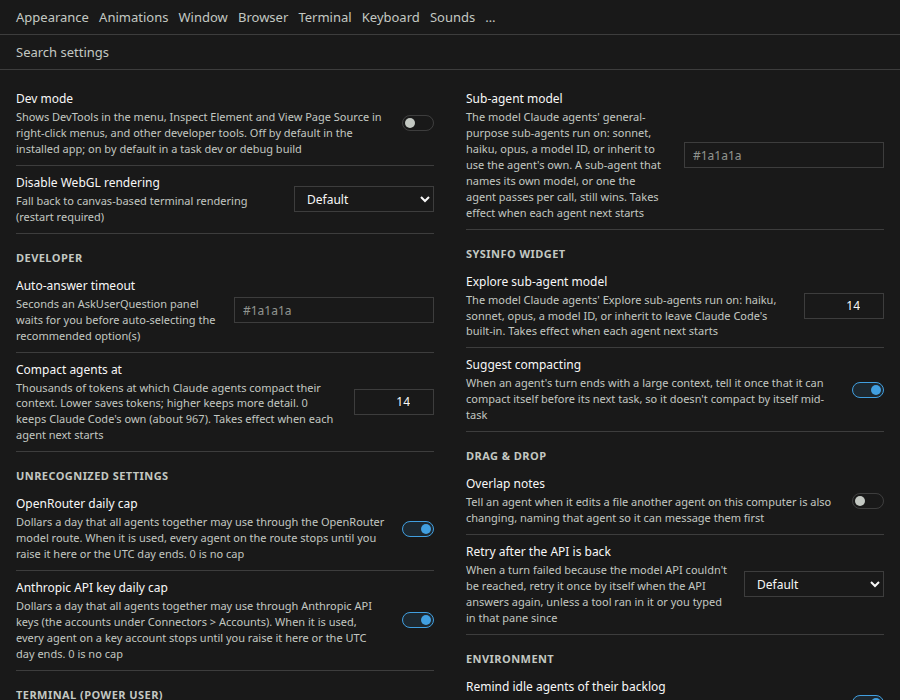
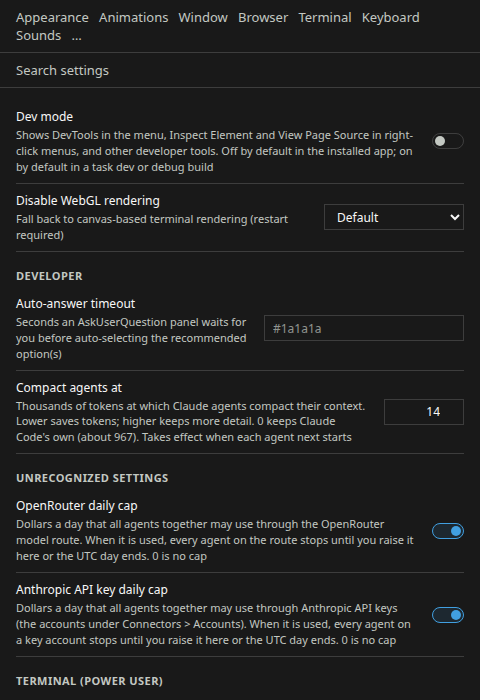
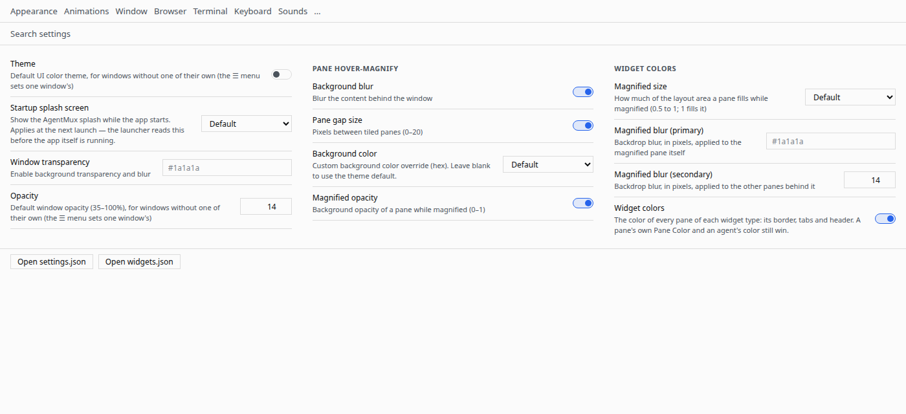

# SPEC: Settings fills a wide pane in several columns of readable width

**Status:** implemented in PR #7942. Spec task #48117, build #48118. Owner: Tansy@narko. Written 2026-11-20 against origin/main `a54adee`.
Everything in sections 2 and 3 was read from the code or measured on a prototype (a static page built from the real compiled `theme.scss`, `element/ui/ui.scss` and `settings.scss`, the real `Field` markup and the real English strings), not run in the app.

## 1. Requirement

On a very wide Settings pane (a maximized window on an ultra-wide monitor), Settings fills the width with several columns, so many settings are visible at once. A column stays a readable width, so a control is never far from the text that explains it. The number of columns follows the width of the Settings pane, not the window or the monitor: a half-width pane on a huge monitor and a maximized one each get what fits. A narrow pane looks and behaves exactly as it does today.

## 2. What exists today

- `SettingsView` (`view/settings/settings-view.tsx`) shows one section at a time under a tab strip. The container `.settings-view-container` is `container-type: inline-size; container-name: settings`, and carries the pane's zoom as a CSS `zoom`.
- Each section renders one `.settings-section-body`, which is also the vertical scroller (`flex: 1 1 auto; overflow-y: auto; display: flex; flex-direction: column`). From a pane width of 1024px the body is capped at `max-width: 720px` and sits at the left. So a maximized pane on a 2200px-wide window is a 752px strip with 1450px of empty space, and a section such as Advanced (21 rows) is 1537px tall and scrolls.
- The children of the body are a flat list: `SectionHeader` (`.settings-subheader`) and `SettingRow` (`.setting-row`) siblings, plus a few larger components (the paired-devices list, the widget list, the keyboard table). There is no wrapper per group.
- A row is a `Field`: text (label and description) on the left, control on the right, wrapping to stacked by itself when narrow. The "Saved" note sits on the label's line and does not change the row's height (`settings-saved-row.layout.test.ts` measures it in a real browser).
- Seven container rules are keyed to the pane's width and assume the content is as wide as the pane: `settings.scss` lines 358 (the 720 cap), 366 (select/text/slider to 100%), 391, 404 and 410 (widget-color swatches, 15 in a line need about 400px), 452 (a device is a card), and `sections/widget-bar-settings.scss` line 62.

## 3. Design

### 3.1 What flows into columns

**Flow sections** (plain `.setting-row` and `.settings-subheader` children): Appearance, Window, Terminal, Sounds, Notifications, Advanced, Agents and Recording. In them, **each direct child of the body is one unit that is never split across columns**: a row with its description, a larger component (the device list, the swatch palette), an inline confirm or expanded panel inside a row. A header stays with the first thing after it (`break-after: avoid`). Two or three rows of one group may land in different columns, which is fine; a header alone at the bottom of a column is not.

**Single sections** keep today's layout (one column, capped at 720px, at the left) and are not changed by this spec: Keyboard (`kb-section`: its own list with focus and key handling), Kanban stages (a reorder list), Animations (the preview), Widgets (the widget bar editor, the installed list and the catalog), Devices (device cards) and Browser (the sites lists). This is the list the Settings code's owner gave from reading the sections. They are marked with the class `settings-section-body--single`. Giving them their own wide layouts is a separate decision per section; none of them is hurt by being left as it is.

### 3.2 Mechanism: CSS multi-column with a width floor

`column-width: 26rem; column-gap: 2rem; column-fill: balance` on the body, `break-inside: avoid` on every child, `break-after: avoid` on `.settings-subheader`. The browser picks the number of columns from the width and grows the columns to fill it, so there is never an empty strip at the right.

Why this and not the others:
- **Grid with auto-fit** needs each group in its own wrapper to be a cell. The sections are flat, so it would mean rewriting every flow section's markup (the Saved-note work touched all of them), and a tall group would leave holes under shorter ones in its row.
- **Masonry by measured height** needs JavaScript and a measure on every change; CSS masonry is not shipped.
- **Multi-column** needs no markup change inside any section, and **the DOM order is the reading order**: it flows down column one, then column two. Tab order and screen-reader order are what they are today, and equal the visual order.

One markup change: the scroller moves out of `.settings-section-body` into a wrapper `div.settings-scroll` that `SettingsView` puts around the section. With the scroller on the body itself, a body of constrained height would put the extra columns to the right, as pages, instead of balancing them down. The body in a flow section becomes `display: block; overflow: visible; max-width: none`. A single section keeps today's rules. Nothing in Settings code reads the body as the scroller (no `scrollTop`, no `scrollHeight`, nothing sticky): the three things that scroll do it through `scrollIntoView`, which only needs some scrollable ancestor: search (`block: "center"` on `#setting-<id>`), the magnified-size row (`block: "nearest"`, run again after a delay because a magnified pane resizes), and a keyboard-section line. The sections that put an id, a ref or a class on their own body (Kanban `id=setting-<stages>`, Animations, Widgets, Keyboard `kb-section`) are single sections and keep them. The section snapshots under `sections/__snapshots__/` that print the body's markup change by the new wrapper and are updated in the same PR.

### 3.3 Widths, gap and breakpoints (measured)

Floor 26rem (416px at 16px), gap 2rem, side padding 1rem as today. Each column needs 26rem and the gap, so n columns fit from a pane width of n × 28rem (side padding and the n − 1 gaps cancel out), and the breakpoints in pane width are:

| Columns | From pane width | Column width at that pane width |
|---|---|---|
| 1 | 0 | the pane's width minus 2rem (as today) |
| 2 | 56rem (896px) | 26rem, growing to about 40rem |
| 3 | 84rem (1344px) | 26rem to about 35rem |
| 4 | 112rem (1792px) | 26rem to about 33rem |
| 5, 6, 7 | 140, 168, 196rem | 26rem to about 32rem |

Measured on the prototype (Advanced section, 21 rows; zoom 100%): pane 480 → 1 column, 900 → 2 (418px), 1400 → 3 (435px), 1800 → 4 (418px), 2200 → 4 (518px), 2800 → 6 (435px), 3400 → 7 (454px). Between breakpoints the columns grow to fill, so a column is always between 26rem and about 40rem wide: a control is at most about 40rem from its text. Below 56rem nothing changes from today, except that today's 720px cap (applied from 1024px) is gone for flow sections, since a pane of 1024px or more is now two or more columns.

Pictures, rendered in Chrome from the prototype (the same Advanced section, English strings and the real stylesheets; the controls are stand-ins chosen by position, so a "cap" row may show a toggle: they show the layout, not each setting's real control).

Today, a 2200px pane: a 720px strip, 1450px unused, and the section scrolls.

Proposed, the same 2200px pane: four columns, 26rem to about 33rem each, a header kept with its first row, the whole section in view.

Today and proposed at 3400px (seven columns):

A short section (Sounds, 17 rows) at 3400px, the case decision D1 is about: seven columns of two or three rows, everything in view, much of the pane empty below.

Settings zoomed to 150% at a 3400px pane: five columns, larger text.

The first breakpoint (two columns at 900px), and a 480px pane, which is the same as today:

The same layout in the light theme, Appearance at 1400px (three columns; the theme's colors apply unchanged):

### 3.4 Reading order, navigation and search

- Order is down a column, then across. It is also the DOM order, so keyboard Tab order and screen-reader order equal it with no extra work. `tabindex` is never used to reorder.
- The section tabs and the search box are above the scroller and do not move.
- Search jumps by `scrollIntoView({ block: "center" })` on the row's id, then adds the highlight class. All columns share one vertical scroll and are always inside the pane's width (the count is chosen so they fit), so a row in the second or third column scrolls into view vertically and is visible horizontally. No change to `handleSelectResult`.

### 3.5 Stability, and the pane-keyed container rules

- **No jump from the Saved note**: it sits on the label line in an always-present live region, so its row does not change height while it shows (existing real-browser test), and it cannot rebalance the columns. The rows that do grow are the magnified-size row in Window (its snap message appears on its own line under it), a "not saved" line under a control, and a section's conditional rows (Recording's engine rows when voice input is turned on). The columns have an auto height (never a fixed one), so growth moves only what is below it in that column and can move a row at a column's end to the next column; the first row of the section never moves. The magnified-size row scrolls itself into view with `block: "nearest"` and runs again after a delay, which still works. This is accepted, and said here so a look check expects it.
- **The narrow rules stay keyed to the pane below 56rem, and ask the row from 56rem.** Below 56rem a section is one column, a row is as wide as the pane less its padding, and the four rules that style rows (`settings.scss`: controls fill the row at a pane of 479px; the widget-color swatches wrap under the chip at 639, then go 8 to a line at 459 and 5 at 259) stay exactly as they were, so a narrow pane is unchanged, whatever a scrollbar takes from the row (a first version asked the row at the pane's threshold less 32px and stacked controls in a pane of 479 to 487px that had a classic scrollbar; the look check found it). From 56rem a section has columns and a row has its column's width, not the pane's: a rule such as "swatches under the chip below 640px of pane" would misfire (15 swatches need about 400px and a column can be 416px). So, inside `@container settings (min-width: 56rem)`, the rows that are direct children of a flow body become `container-type: inline-size; container-name: setting-row`, and the same rules ask the row: controls fill the row at 447px (423px for an indented row, which has its 24px padding less), the swatches wrap at 583px of an indented row, 8 to a line at 403 and 5 at 203. A narrow pane has no new containers. The other pane-keyed rules stay as they are, because their sections do not flow: 452 (device cards, Devices), `sections/widget-bar-settings.scss` 62 (Widgets) and 358 (the 720 cap), which now applies to single sections only. A classic scrollbar narrows the body by its width, so the pane width for n columns is n × 28rem plus the scrollbar; a pane in the few pixels between has one fewer column, which looks like the narrower pane's.
- **To verify in the build, not assumed:** `container-type` on a row gives it layout containment, which makes it the containing block of any `position: fixed` descendant. If any control inside a row opens a fixed-position popover that is not portaled, it would be positioned against the row. The build checks this for every control used in a flow section's rows (select, color picker, masked key field) before it relies on it; if one is affected, that row's rules stay keyed to `settings` as today.
- **Row borders:** `.setting-row:last-of-type { border-bottom: none }` removes the line under the last row of the section only. In columns, each column's last row keeps its bottom line, which reads as a separator. No change.

### 3.6 Zoom

Settings zoom is a CSS `zoom` on `.settings-view-container`, which is also the query container, so the width in `rem` is measured in the zoomed box and the column count falls as the zoom rises, as wanted. Measured (pane width screen px → columns; Advanced): zoom 100%: 900 → 2, 1400 → 3, 2200 → 4, 3400 → 7; zoom 125%: 900 → 1, 1400 → 2, 2200 → 3, 3400 → 6; zoom 150%: 900 → 1, 1400 → 2, 2200 → 3, 3400 → 5. Chrome zoom (title bar, pane headers) does not scale the Settings content.

## 4. Edge cases

1. A section with few rows (Window has 7, Sounds 17) in a wide pane: balance spreads them thin (Sounds at 3400px: 7 columns of two or three rows). They are all in view at once, which is the point, so no cap is proposed (decision D1).
2. A row taller than the pane (a long description at a narrow column): it stays whole; the scroller scrolls.
3. A pane resized by dragging: the count changes at the breakpoints; rows reflow, the scroll position stays.
4. Magnified pane (zoom above 150%): one or two columns, as the table says.
5. RTL: columns flow right to left with the writing direction; nothing to do.
6. Print and screenshots: not affected.

## 5. Tests

- **Real-browser layout test (`settings-columns.layout.test.ts`)**, in the same style as `settings-saved-row.layout.test.ts` (compiled `ui.scss` and `settings.scss`, `findBrowser`/`measureInBrowser`, skipped with no usable browser): for panes of 480, 895, 896, 1343, 1344, 2200 and 3400px, and zoom 100% and 150%, the number of distinct row x-positions equals the table in 3.3; no row is split; a `.settings-subheader` is never the last item of a column; a single section stays one 720px column; controls stack at a pane of 479px and not at 480 to 494px, with and without a classic scrollbar; Window's magnified-size row grown by its message keeps the rest of the column in place below it.
- **Contract test** on the compiled CSS: the pane-keyed narrow rules are as they were; the `@container setting-row` rules exist only inside the 56rem query, at the thresholds in section 3.5; the 720px cap is on `.settings-section-body--single` only.
- **Search test (jsdom)**: choosing a result whose row is the last in the DOM scrolls it into view and adds the highlight class (no change expected; it pins 3.4).
- **Existing tests** (`settings-view.test.tsx`, the sections' tests) pass unchanged.
- **Look-check matrix** (macOS and Linux, before merge): pane widths about 480, 900, 1400, 2200 and 3400px; light and dark; Settings zoom 100% and 150%; on Advanced (many rows), Sounds (short), Appearance (the widget-color swatches in a column) and Devices (still one column). Pass or fail per cell, with screenshots of anything wrong. Look for: a control far from its text, a header alone at a column bottom, swatches overflowing a column, a popover misplaced (3.5).

## 6. Plan and size

One PR, about a day. Files: `settings-view.tsx` (the `settings-scroll` wrapper), `settings.scss` (flow rules, the row-keyed rules from 56rem), `sections/widget-bar-settings.scss`, the six single sections' body class (`keyboard-section.tsx`, `kanban-section.tsx`, `animations-section.tsx`, `widgets-section.tsx`, `devices-section.tsx`, `browser-section.tsx`), the updated section snapshots, the new layout test, the changeset. Media on the card: before and after at 2200 and 3400px. Not in scope: wide layouts for the six single sections; changing any row's markup; a column cap.

## 7. Decisions

- **D1. Many columns on a short section.** Recommended: no cap, columns follow the width (seven at 3400px). Alternative: cap the count by how many rows a section has (for instance at least four rows to a column), which leaves empty space at the right of a short section on a very wide pane.
- **D2. Column floor.** 26rem (416px) is recommended: two columns from 896px, so a Settings pane 1920px wide gets four. A wider floor (30rem) gives fewer, roomier columns: two from 1024px, three from 1536px.
- **D3. The six single sections** (Keyboard, Kanban stages, Animations, Widgets, Devices, Browser) stay as they are in this change (recommended), against flowing some of them too.
