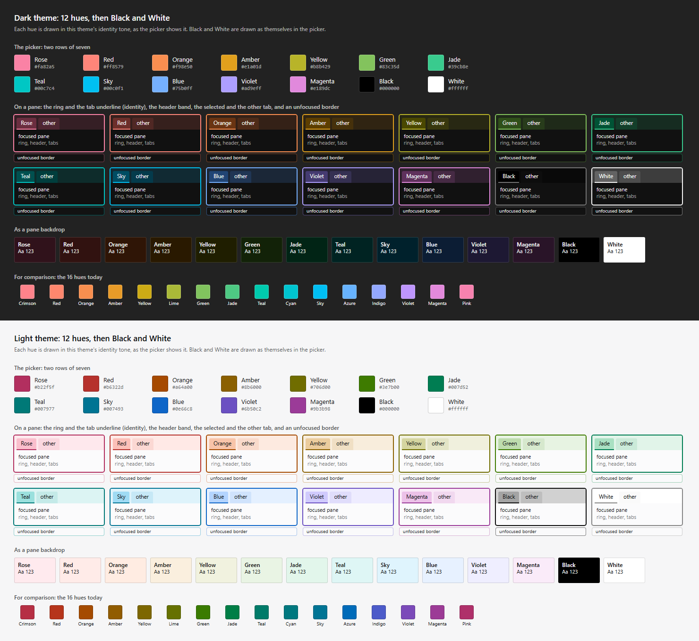

# SPEC: the shared palette becomes 12 evenly spaced hues plus Black and White (14 slots, down from 16)

**Date:** 2026-11-16
**Author:** Agent1@narko
**Status:** active. Approved by the operator, 2026-11-16 (relayed by AgentY), every decision of §10 as recommended. Spec task #47850; built as #47851.
**Verified against:** `origin/main` @ `b99a6f020a`, by reading the files named in §7 and by running the calculations in §2 and §3 (a throwaway script; §2.1 says how the build lands it as a checked tool).
**Changes:** [`SPEC_SHARED_PERCEPTUAL_PALETTE_16_2026_11_01.md`](SPEC_SHARED_PERCEPTUAL_PALETTE_16_2026_11_01.md) (the 16 slots and their names; its method, its single source and its role tones are kept). It touches the built-in list of [`SPEC_PANE_BACKGROUND_THEMES_2026_11_15.md`](SPEC_PANE_BACKGROUND_THEMES_2026_11_15.md) §3.2.

## 0. The ask

Requested by the operator, 2026-11-16: fewer colours, because too many of the 16 look like each other; recompute the evenly spaced points for 12 instead of 16; then add black and white, for 14 in all.

## 1. Summary

- **12 hues**, placed by the 16-spec's own method (equal perceptual arc length around the identity ring, both themes weighted equally). They are recomputed, not 16 with four removed. Neighbours are now **12.9 to 17.4** apart in the dark theme and **13.8 to 16.4** in the light one (CIEDE2000), against 9.9 to 13.3 and 10.3 to 13.0 for the 16. The closest two neighbours of the 12 are further apart than the average two neighbours of the 16 (12.0 dark, 11.6 light).
- **Black and White** are two more slots, with no hue. Each role gets a lightness of its own for them (§3), because a black line cannot be seen on dark chrome and a white one cannot be seen on light chrome.
- **Nothing a person chose is lost.** Each of the 16 goes to its nearest of the 12 (§5): twelve keep a slot of their own (Azure and Pink under the plainer names Blue and Rose), and four merge into a neighbour (Crimson into Red, Lime into Yellow, Cyan into Teal, Indigo into Violet). The six ids that go away keep working as aliases.
- **Black and White are never handed out automatically.** A new agent or profile gets one of the 12 hues; a neutral is a person's (or an agent's) own choice (§6).
- **A limit, stated plainly:** 12 hues are easier to tell apart for everyone with typical colour vision, but they do not fix red-green colour blindness: the worst pair (Blue and Violet) is still under 1 for a deuteranope (§2.3). Names, check marks and the agent's name beside its colour stay the answer, as in the 16-spec.

*(A swatch sheet rendered by a headless browser from the real tone formulas and the tones proposed in §3. Not a screenshot of AgentMux: nothing is built yet.)*

## 2. The 12 hues

### 2.1 Method

The 16-spec's §4.2, unchanged, with 12 in place of 16:

1. The identity tone of each theme as the app draws it (dark `L 0.75, C 0.15`, light `L 0.52, C 0.17`, chroma lowered per hue until it fits sRGB).
2. Walk the hue circle in 0.1° steps and sum CIEDE2000 between consecutive colours: the ring is 191.4 long in the dark theme and 185.3 in the light one.
3. Average the two normalised length curves and cut the circle into 12 equal parts.
4. Slide the starting point across one slot width, keep the placement whose worst pair under simulated colour blindness (Machado 2009, full dichromacy) is best, and round to whole degrees.
5. The stored hex of a slot is `L 0.70, C 0.14` at its hue.

The script was checked against the 16 on main first: it gives their published neighbour distances exactly (9.9 to 13.3 dark, 10.3 to 13.0 light). The 16-spec's tool was never committed; **the build lands this one as `scripts/palette-tool.mjs`** (prints the tables of this section, and `--check` fails when `schema/color-palette.json` no longer matches the method), so the next retune is one command.

The starting point barely matters, as it did for 16: across the slide the closest neighbours move only between 12.7 and 13.9, and the worst colour-blind pair between 0.06 and 0.41.

### 2.2 The slots

| # | Name | OKLCH hue | Stored hex | Dark identity | Light identity |
|---|---|---|---|---|---|
| 0 | Rose | 3° | `#e47696` | `#fa82a5` | `#b22f5f` |
| 1 | Red | 27° | `#e8796e` | `#ff8579` | `#b6322d` |
| 2 | Orange | 49° | `#e38149` | `#f98e50` | `#a64a00` |
| 3 | Amber | 78° | `#cd9219` | `#e1a01d` | `#8b6000` |
| 4 | Yellow | 108° | `#a7a425` | `#b8b429` | `#706d00` |
| 5 | Green | 135° | `#77b154` | `#83c35d` | `#3e7b00` |
| 6 | Jade | 161° | `#33b981` | `#39cb8e` | `#007d52` |
| 7 | Teal | 193° | `#00b5b3` | `#00c7c4` | `#007977` |
| 8 | Sky | 225° | `#00afdc` | `#00c0f1` | `#007493` |
| 9 | Blue | 256° | `#61a0f4` | `#75b0ff` | `#0e66c8` |
| 10 | Violet | 290° | `#9e8eef` | `#ad9eff` | `#6b50c2` |
| 11 | Magenta | 329° | `#cd7dc9` | `#e189dc` | `#9b3b98` |
| 12 | Black | none | `#000000` | §3 | §3 |
| 13 | White | none | `#ffffff` | §3 | §3 |

Each stored hex keeps its hue through 8-bit rounding to within 0.45°. A slot's id is its lower-case name. Ten names are kept from the 16; **Rose** and **Blue** are new (Pink and Azure moved a few degrees and take the plainer names); Crimson, Lime, Cyan and Indigo go (§5).

### 2.3 Measured, next to the 16 (CIEDE2000, both sets through the same script)

| Check | The 16 today | The 12 |
|---|---|---|
| Neighbours, dark theme, identity tone | 9.9 to 13.3 | **12.9 to 17.4** |
| Neighbours, light theme, identity tone | 10.3 to 13.0 | **13.8 to 16.4** |
| Neighbours, border tone | 7.5 to 10.5 dark, 5.6 to 9.2 light | 9.7 to 12.8 dark, 7.7 to 11.3 light |
| Neighbours, pill tone | 4.9 to 8.6 dark, 3.5 to 6.9 light | 7.2 to 11.3 dark, 5.0 to 9.8 light |
| Identity against its own pill, selected pill and header tint (contrast, worst) | 4.19 dark, 3.45 light | 4.21 dark (Rose), 3.48 light (Green); all pass 3:1 |
| Protanopia: pairs closer than 5, and the worst pair | 8 of 120 (7%) dark, 10 (8%) light; worst 1.7 | 3 of 66 (5%) dark, 4 (6%) light; worst 2.5 |
| Deuteranopia: the same | 18 of 120 (15%) dark, 21 (18%) light; worst 0.3 | 8 of 66 (12%) dark, 13 (20%) light; worst 0.4 (Blue, Violet) |
| Tritanopia: the same | 12 of 120 (10%) dark, 11 (9%) light; worst 1.5 | 6 of 66 (9%) dark, 5 (8%) light; worst 2.4 |

Reading it: for typical colour vision every neighbour pair is about a third further apart, and the quiet tones (borders, pills) gain the most in proportion. For colour-blind users the count of confusable pairs falls with the count of colours, but the share stays about the same and the worst pairs stay confusable. That is a property of a hue ring at one lightness, not of the count; Black and White are the two slots every kind of colour vision tells from the rest.

## 3. Black and White

### 3.1 The rule

A hue slot gives every role the same lightness and chroma, so a role looks equally strong in every colour. A neutral cannot do that: where the theme's own chrome is near black, a black line or fill has nothing to stand against, and the same holds for white on light chrome. So a neutral gets **a lightness per role and theme, with no chroma**, chosen by three requirements:

1. **Lines** (the focused ring, the tab underline, a selected Swarm row: the `identity` role) reach 3:1 against every surface they are drawn on. Where the neutral itself cannot (Black in the dark theme, White in the light one), the line steps toward the middle until it does: a graphite line for Black on dark, a silver line for White on light.
2. **Fills** (pills, the header band) stay in the range where the theme's own text keeps 4.5:1, and go to the neutral's own colour where they can: true black fills in the dark theme, true white fills in the light one.
3. **Where a neutral is shown for itself** (the picker's swatch, a profile chip, a pane backdrop, the stored value), it is exactly `#000000` or `#ffffff`, in both themes, with a hairline around a swatch so a black swatch shows on a dark menu and a white one on a light menu.

### 3.2 The tones (OKLCH lightness, chroma 0)

| Role | Dark: Black | Dark: White | Light: Black | Light: White |
|---|---|---|---|---|
| `identity` (ring, underline) | 0.56 `#747474` | 0.97 `#f5f5f5` | 0.15 `#0b0b0b` | 0.62 `#868686` |
| `border` (unfocused pane) | 0.40 `#484848` | 0.62 `#868686` | 0.55 `#717171` | 0.84 `#cacaca` |
| `pill` | 0.16 `#0d0d0d` | 0.42 `#4d4d4d` | 0.80 `#bebebe` | 0.985 `#fafafa` |
| `pillActive` | 0 `#000000` | 0.50 `#636363` | 0.72 `#a4a4a4` | 1 `#ffffff` |
| `headerTint` | 0.14 `#090909` | 0.36 `#3d3d3d` | 0.86 `#d1d1d1` | 1 `#ffffff` |
| `widgetTint` (top-bar icon) | 0.56 | 0.97 | 0.15 | 0.62 |
| Picker swatch, profile chip, backdrop, stored hex | `#000000` | `#ffffff` | `#000000` | `#ffffff` |

They live beside `PANE_COLOR_TOKENS` in `pane-color-scheme.ts`, so there is still one place to tune the look, and `paneRoleColor` stays the one function every surface asks.

### 3.3 Checked

| Check | Dark: Black | Dark: White | Light: Black | Light: White |
|---|---|---|---|---|
| Identity line against its pill, selected pill, header tint (worst) | 4.16 | 5.51 | 7.90 | 3.49 |
| Identity line against the window, the tab strip, the pane and the neutral header (worst) | 3.11 | 13.3 | 17.0 | 3.14 |
| The theme's text on its pill, selected pill, header tint (worst) | 18.1 | 5.61 | 7.70 | 18.4 |
| Its identity line against the nearest hue's identity line (CIEDE2000) | 29.6 | 27.7 | 35.9 | 21.9 |
| Black's identity line against White's (CIEDE2000) | 35.8 | | 40.7 | |

Every line clears 3:1 and every text clears 4.5:1. Each neutral's line is further from the other's, and from every hue's, than any two neighbouring hues are from each other (17.4 at most).

### 3.4 On each surface

| Surface | Black | White |
|---|---|---|
| Picker (`PaletteSwatches`, the Pane Color menu) | a black swatch with a hairline, named "Black", check mark when chosen | a white swatch with a hairline, named "White" |
| Pane ring and tab underline | dark theme: graphite; light theme: black | dark theme: white; light theme: silver |
| Pane header band and tab pills | dark theme: black band and pills, darker than the neutral header; light theme: grey band and pills, darker than any hue's | dark theme: grey band and pills, lighter than any hue's; light theme: white, as an uncoloured pane's (see the limit below) |
| Agent colour (Swarm row, Kanban, tower and attention lists) | `ui:color` is `#000000`; every one of these draws it through `paneRoleColor`, so it gets the tones above. A reader that paints the stored hex as it is paints black and needs a hairline (§7) | `#ffffff`, the same |
| Window tab | the pill tones above with the identity underline | the same |
| Browser profile chip | black chip, white initial | white chip with a hairline, black initial |
| Pane backdrop | a black surface (`#000000`) with light ink, **in both app themes** | a white surface (`#ffffff`) with dark ink, in both app themes |

**Backdrops.** A hue's built-in backdrop is a deep tone under a dark app theme and a pale one under a light theme. Black and White are not: a person who picks a black backdrop means black, whatever the app theme, so the two neutrals keep one surface each and the pane's Dark / Light / Follow choice does not change them (as it does not change a custom colour today). Their ink comes from `deriveInk`, like every other backdrop.

**The limit.** The neutral that matches the theme is quiet by nature. In the light theme a White pane has the uncoloured pane's white header and pills; what marks it is its silver ring and underline (3.1:1 and up) where an uncoloured pane has the accent's. In the dark theme a Black pane's fills are darker than the chrome by 1.3:1 to 1.4:1, which reads as an area but would not as a line; its graphite ring carries it. The swatch sheet shows both. If that is too quiet, the alternative is a hairline around the near neutral's pills and header on every surface, which is more to build and to keep consistent; it is decision N2.

## 4. The palette file

`schema/color-palette.json` stays the single source for TypeScript and Rust. Version 2 adds two things:

- A slot may be `"neutral": "black"` or `"neutral": "white"` in place of a hue. `slotOf` and `snap_hex` read a stored colour whose chroma is under 0.02 as a neutral (Black under lightness 0.5, White above), and everything else by hue as today. No slot hex and none of the old Tailwind hexes is that grey, so nothing stored today changes meaning; the slate of the old profile list (chroma 0.04) still reads as Blue.
- A `retired` table: the six ids that go away, and all 16 of today's stored hexes, each with the slot it now means (§5). `slotById`, `slotOf` and `snap_hex` consult it before measuring a hue, so an old value resolves the same way in both languages and before and after the migration.

## 5. Colours already chosen

### 5.1 Where each of the 16 goes

| Today | Hue | Becomes | Hue moves by | Seen difference (CIEDE2000) |
|---|---|---|---|---|
| Crimson | 17° | **Red** | 10° | 6.9 |
| Red | 33° | Red | 6° | 4.6 |
| Orange | 50° | Orange | 1° | 0.6 |
| Amber | 71° | Amber | 7° | 3.7 |
| Yellow | 94° | Yellow | 14° | 7.3 |
| Lime | 116° | **Yellow** | 8° | 4.6 |
| Green | 136° | Green | 1° | 0.5 |
| Jade | 155° | Jade | 6° | 3.0 |
| Teal | 178° | Teal | 15° | 7.4 |
| Cyan | 202° | **Teal** | 9° | 4.5 |
| Sky | 226° | Sky | 1° | 0.6 |
| Azure | 250° | Blue (renamed) | 6° | 3.3 |
| Indigo | 273° | **Violet** | 17° | 7.4 |
| Violet | 301° | Violet | 11° | 4.5 |
| Magenta | 330° | Magenta | 1° | 0.4 |
| Pink | 357° | Rose (renamed) | 6° | 3.2 |

**The four pairs that merge:** Crimson and Red, Yellow and Lime, Teal and Cyan, Indigo and Violet. Two agents, tabs or panes that differ only by one of those pairs will match after the change. Every other colour moves by less than a neighbour's distance and keeps a slot of its own.

Indigo is the one case the hue alone does not settle: 273° is 17° from both Blue and Violet. As seen, it is nearer Violet (7.4 against 8.1), and the older Tailwind Indigo lands on Violet too, so the table says Violet. That is why the mapping is a table in the palette file and not a measurement at read time.

### 5.2 What is rewritten, and what is only read differently

- **A migration, like `m0045_palette_snap`** (the next free number): every agent's `ui:color` and every browser profile's colour that is one of the 16 hexes becomes its new slot's hex; any other colour is snapped as §4 says. Idempotent, and a value that is already one of the 14 is left alone with its `updated_at`.
- **Read-side only, as today:** a window tab's `tab:color`, a pane's `frame:color` id and legacy `frame:hue`, `pane:colors`, a backdrop's built-in id, and a widget manifest's `defaultColor`. The six retired ids (`crimson`, `lime`, `cyan`, `azure`, `indigo`, `pink`) resolve through the `retired` table, and the value becomes a current one the next time it is written.
- **Widget defaults.** Seven built-in widgets name a retired id (`lime`: browser, identity; `indigo`: terminal, drone; `cyan`: files; `azure`: toolchain; `pink`: shortcuts). The build rewrites their manifests to the new ids: each takes its alias, except terminal and drone, which take Blue, since Violet already has three widgets. One manifest (`reviews`) names `blue`, which is not a slot today, so that widget has no colour; it gets one with this change.

## 6. Automatic colours

- `pick_slot` and `pickSlot` (a new agent) and `farthest_free_slot` (a new browser profile) choose among **the 12 hues only**. Black and White are given only when someone picks them: from a picker, or by an agent through whatever sets a colour.
- The rule is otherwise unchanged: the least-used hue among the existing agents, ties broken from the hash of the agent's id. The first 12 agents all differ; 25 agents use no hue more than three times (two with 16 slots). That is the price of fewer, clearer colours, and the agent's name is beside its colour everywhere.
- An agent that someone made Black or White is counted as using no hue, so it does not skew the spread.

## 7. Every place that assumes 16

| Place | Today | Change |
|---|---|---|
| `schema/color-palette.json` | 16 slots, version 1 | 14 slots, version 2, the `retired` table (§4) |
| `frontend/app/theme/palette.ts`, `crates/srv-core/src/backend/palette.rs` | a slot always has a hue; snap by hue | a slot has a hue or is a neutral; the neutral test and the `retired` table; the pick functions skip neutrals |
| `frontend/app/block/pane-color-scheme.ts` | `paneRoleColor` turns a hue into a tone | also returns the §3.2 tone for a neutral; `identityOklchHue` is no longer the only way in (a neutral has no hue) |
| `frontend/app/components/palette-swatches.tsx`, `.scss` | two rows of 8 (9 and 8 with the "none" swatch) | **two rows of 7** (8 and 7 with "none"): the hues Rose to Jade, then Teal to Magenta, Black, White. A hairline on every swatch |
| `frontend/app/block/blockframe.tsx` (the Pane Color menu) | Default, then 16 names | Default, then 12 names, a separator, Black and White |
| `frontend/app/backdrop/builtins.ts`, `BackdropPicker.tsx`, `picker-model.ts`, `meta.ts` | 16 built-ins in a 4 by 4 grid; a built-in is a hue | 14 built-ins; **7 by 2** in the same order as the pane picker; the two neutrals keep one surface in both app themes (§3.4); retired ids resolve |
| `crates/srv-core/src/backend/agent_color.rs`, `browser_profiles_store.rs` | "no colour repeats until all 16 are in use" | 12; `is_valid_agent_color` accepts the 14 |
| Readers of an agent's stored hex: `kanban-colors.ts`, `tower-agents.tsx`, `attention-list.ts` in this repo; srv's Kanban `agent_colors`; the mobile app | the three frontend readers draw through `paneRoleColor`; srv hands the hex on; the mobile app reads `ui:color` (16-spec §7) | the frontend readers need nothing. Not verified here: how the mobile app paints the hex (the clone in my workspace predates the palette). If it paints it as it is, a black or white chip needs a hairline there; QTest is told at build time |
| The web viewer (`frontend/web-host`) | shares `palette.ts` | nothing of its own |
| Tests: `palette.test.ts`, `palette.rs`, `agent_color.rs`, `palette-swatches.test.tsx`, `pane-color-scheme.test.ts`, `backdrop/ink.test.ts`, `meta.test.ts`, `picker-model.test.ts`, `BackdropPicker.test.tsx` | count 16, name `crimson`, `jade`, `azure` | §9 |
| Docs: `agentmux-docs` `pane-types.md` (the list of 16 names) and `internals/state-model.md` (the hex table) | 16 | 14, in the docs PR that follows the build |
| The 16-spec and the backdrop spec | 16 | a line at the top of each pointing here |

## 8. Other open work

- **The Style tool (#47778 spec, #47779 build):** its `backdrop` value is a built-in id. It reads the list from the palette, so it takes the 14 and the aliases with no change of its own; its spec's examples that name `azure` are reworded when it is built.
- **Backdrops for terminals, widgets and the browser (#47696 phase 2):** reads `BUILTINS`, which follows the palette. Either lands first.
- **#47798** is a Vault spec and does not touch colours.

## 9. Build plan and tests (task #47851)

One PR: the palette file and the two readers, the neutral tones, the pickers' new shape, the migration, the manifests, `scripts/palette-tool.mjs`, and the tests below. The docs PR follows. A visual change: macOS and Linux look checks before merge.

- **Palette (TS and Rust):** 14 slots, 12 with hues in ascending order and 2 neutrals; ids unique; each hue's hex round-trips to its hue within 0.5°; neighbour CIEDE2000 at the identity tone at least 12.5 in both themes; `palette-tool.mjs --check` passes.
- **Contrast:** for all 14 in both themes, the identity tone is at least 3:1 against its pill, selected pill and header tint; for the two neutrals also against the window, tab strip, pane and neutral header colours, and the theme's text is at least 4.5:1 on each neutral fill.
- **Snap:** each of the 16 old hexes and each of the six retired ids resolves to the slot of §5.1, in both languages; `#000000`, `#ffffff` and a mid grey resolve to Black, White and the nearer of the two; a slate with chroma 0.04 still resolves to a hue; junk is no colour.
- **Pick:** never a neutral; the first 12 agents differ; 25 agents use no hue more than three times; a Black agent does not count against a hue; a new profile never takes a neutral.
- **Migration:** every one of the 16 hexes is rewritten as §5.1 says; a second run changes nothing; a custom hex is snapped; Black and White are left alone.
- **Pickers:** 14 swatches (15 with "none") in two rows; each named; the chosen one checked; a retired id shows its new slot as chosen. The backdrop picker has 14, and a Black backdrop is `#000000` under both app themes.

## 10. Decisions for the operator

| | Question | Recommendation |
|---|---|---|
| **N1** | The 12 hues and their names: Rose, Red, Orange, Amber, Yellow, Green, Jade, Teal, Sky, Blue, Violet, Magenta (§2.2). | Yes. As before, names are the part that is costly to change later. |
| **N2** | Black and White as drawn in §3 and on the swatch sheet: graphite ring for Black on the dark theme, silver ring for White on the light theme, fills as the neutral's own colour where the theme's text still reads. The other way is a hairline around the near neutral's fills on every surface. | As drawn. Add the hairline later only if a Black pane on dark, or a White one on light, proves too quiet in use. |
| **N3** | The four merges and two renames of §5.1, with a migration, so some agents, tabs and panes shift once, by up to 17° of hue. | Yes. |
| **N4** | Black and White only by choice, never assigned automatically (§6). | Yes. |
| **N5** | A Black or White backdrop is the same surface in both app themes (§3.4). | Yes: it is what the name says. |
| **N6** | The picker's shape: two rows of seven, the 12 hues in order and then Black and White; the backdrop picker the same (7 by 2 in place of 4 by 4). | Yes. |
