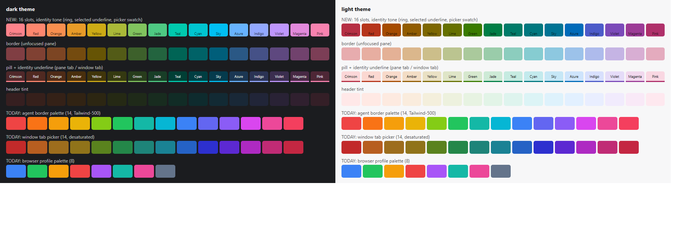

# SPEC: one shared 16-colour palette, evenly spaced by human perception, for panes, agents, tabs, windows and browser profiles

**Date:** 2026-11-01
**Author:** Agent1@narko
**Status:** active. Approved by the operator, 2026-11-01 ("Approve the palette spec", relayed by AgentY), all five §12 decisions as recommended. Spec task #17138; being built as #17139 in two PRs (§10).
**Verified against:** `origin/main` @ `0670e7669`, by reading the files named in §2 and by running the calculations in §4 (a throwaway script, not committed; §4.2 lists every step so the build can recreate it as a checked tool).
**Builds on / replaces:** [`SPEC_PANE_COLOR_SYSTEM_CONSOLIDATION_2026_09_20.md`](SPEC_PANE_COLOR_SYSTEM_CONSOLIDATION_2026_09_20.md), [`SPEC_WIDGET_DEFAULT_PANE_COLORS_2026_10_05.md`](SPEC_WIDGET_DEFAULT_PANE_COLORS_2026_10_05.md), [`SPEC_AGENT_COLOR_2026_08_08.md`](SPEC_AGENT_COLOR_2026_08_08.md). It overrides the "must not share one source" rule of [`SPEC_TAB_COLOR_DESATURATION_2026_08_13.md`](SPEC_TAB_COLOR_DESATURATION_2026_08_13.md) (§6 says why that is now safe). The role tones (`PANE_COLOR_TOKENS` in `pane-color-scheme.ts`) are kept as they are.

## 0. The ask

The operator, 2026-11-01: sixteen colours, **equidistant by human perception**, researched against the latest work; and **one DRY palette** that panes, agents, tabs, windows and browser profiles all derive from, instead of five lists that happen to agree.

## 1. Summary

- Today there are **five unrelated lists** (§2): 14 Tailwind hexes for agents (mirrored in Rust), 14 desaturated hexes for window tabs, 12 HSL hues for the Pane Color menu and widget defaults, 8 hexes for browser profiles (mirrored in Rust, with its own pick rule), and a few more. They disagree on names, count and hue, and they are not evenly spaced: the 14 agent hues are 9° to 47° apart in OKLCH, and the two closest agent colours (Indigo, Violet) differ by only ΔE2000 7.2. The profile list has a grey in it.
- Proposal: **one file, `schema/color-palette.json`, with 16 slots.** Each slot is a name, an OKLCH hue, and one canonical `#rrggbb`. TypeScript imports it; Rust `include_str!`s it (the repo's tests already `include_str!` the `schema/*.json` files). No code generation, so nothing can drift.
- A slot is only a **hue**. Every surface keeps deriving its own tone from the hue per role and theme, through the existing `paneRoleColor` and `PANE_COLOR_TOKENS`. That is why tabs, pills, borders, headers and widget icons can share the palette and still look right in both themes (§5).
- The 16 hues are placed so that **neighbouring colours are equally far apart as people see it** (CIEDE2000 10 to 13 in both themes, against 7 to infinity today). §4 has the method and the numbers.
- Nothing stored needs rewriting to keep working: any old hex or HSL hue is snapped to its nearest slot when read (§5.3). A one-time migration then writes the canonical value so the data is clean (§7, decision D2).
- **A limit, stated plainly:** no set of 16 hues is distinguishable for people with red-green colour blindness by colour alone (§4.4). The palette is a way to tell agents apart quickly, not the only way: every swatch has a name and a check mark, and an agent always has its name beside its colour.



*(Screenshot of the swatch sheet in both themes, rendered by headless Chrome from the real tone formulas, with today's agent, window-tab and profile palettes underneath. Not a screenshot of AgentMux itself: nothing is built yet.)*

## 2. Inventory: every palette today

| # | Palette | Where | Size | Stored as | Mirror / other readers |
|---|---|---|---|---|---|
| 1 | Agent border palette (Tailwind-500) | `frontend/app/view/agent/agent-color.ts` `AGENT_COLOR_PALETTE`, `pickAgentColor`, `dimAgentColor` | 14 | hex, agent content `ui:color`; seeded to block meta `frame:activebordercolor` and `frame:bordercolor` (`app_api/agent_open.rs`) | Rust `crates/srv/src/backend/agent_color.rs` (same 14, `pick_agent_color` FNV-1a, `dim_agent_color` x0.55), migration `m0020_agent_color_backfill`, Kanban `agent_colors` (`app_api/kanban.rs`), `agent_seat.rs`, `pane_env.rs` |
| 2 | Window-tab picker | `frontend/app/tab/tab.tsx` `TAB_COLORS` | 14, desaturated copies of #1 | hex, tab meta `tab:color` | `windowTabToneVars` reads only the **hue** of the hex and draws the pill in pane tones |
| 3 | Pane Color menu | `frontend/app/block/pane-color-menu.ts` `PANE_HUE_OPTIONS`, `hueToActiveBorder`, `hueToAgentIdentityColor` | 12 hues, 30° apart in **HSL** | number (HSL degrees), block meta `frame:hue`; an agent pick also writes `ui:color` as `hsl(h,65%,52%)` hex | `identityOklchHue` converts HSL to OKLCH |
| 4 | Widget default colours | `defaultHue` in each widget manifest (`agent-manifest.tsx` 30, `browser.tsx` 60 …), setting `pane:colors`, `widget-colors.tsx`, `action-widgets-config.ts` | the same 12 hue steps, plus sandboxed widgets' `default_hue` | number (HSL degrees) | `widgetHueFor`, `widgetRoleColor` |
| 5 | Browser profile palette | `frontend/app/view/browser/browser-profiles.ts` `PROFILE_COLORS`; `new-profile-modal.tsx` | 8, one of them grey (`#64748b`) | hex in `browser-profiles.json` | Rust `browser_profiles_store.rs` `PALETTE`; srv picks `PALETTE[len % 8]`, which repeats a colour after any delete |

Already shared, and kept: `frontend/app/block/pane-color-scheme.ts` turns **a hue into a colour for a role in a theme** (OKLCH, one fixed lightness and chroma per role: identity, border, pill, pillActive, headerTint, widgetTint), and `pane-identity.ts` is the one place that decides where a pane's hue comes from (its own pick, then its agent, then its widget). The palette slots into the first step of that chain; nothing downstream changes.

Not palette members (out of scope, §9): semantic colours (ok, warn, error), Kanban stage colours, terminal ANSI colours, chart colours, and the neutral greys.

## 3. What the research says

- **Space for even spacing.** Oklab/OKLCH is the right space to *rotate hue* at a fixed lightness and chroma: it was fitted to CAM16 predictions and keeps perceived chroma constant around the circle, which an ellipsoidal space does not ([Ottosson](https://bottosson.github.io/posts/oklab/); the 2026 comparisons below agree).
- **Metric for "how different do two colours look".** For the difference between two colours, CIEDE2000 predicts observers better than plain Oklab distance: on the COMBVD data a 2026 comparison reports STRESS 29.2 for CIEDE2000, 33.5 for CAM16-UCS and 47.4 for Oklab ([arXiv 2606.05255, Oklch+](https://arxiv.org/html/2606.05255v1); [arXiv 2601.19680](https://arxiv.org/pdf/2601.19680)). The Oklab authors said the same: it was tuned for hue uniformity, not for colour-difference accuracy. So: **place hues in OKLCH, judge spacing with CIEDE2000**. CAM16-UCS is no better for this job and is numerically awkward.
- **Newer spaces** ([Helmlab, arXiv 2602.23010](https://arxiv.org/html/2602.23010), Li and Luo's 2024 simple appearance model) claim better blue-region behaviour. They are research, not yet in CSS or any library we ship; the palette file stores plain OKLCH hues, so a later retune is one file.
- **How many categories people can tell apart.** Practical guidance puts reliable, colour-blind-safe categorical sets at 6 to 8, and a visual-search study puts efficient search under 7 colours ([arXiv 2103.06084](https://arxiv.org/pdf/2103.06084); [colourblind-safe palette guide](https://colorblind.io/guides/colorblind-safe-palettes); [The Node](https://thenode.biologists.com/data-visualization-with-flying-colors/research/)). Sixteen is beyond that for colour alone. It is workable here because the identity colour is always paired with a name, the agent's position is spatial, and the palette is used to spread many items, not to be decoded by colour alone. Beyond 12 the field's own advice is redundant cues (shape, label), which §4.4 adds.
- **What the repo already settled** and this spec keeps: roles are derived in OKLCH at fixed L and C so no hue is louder than another ([`REPORT_PANE_TAB_COLOR_BEST_PRACTICES_2026_10_02.md`](../reports/REPORT_PANE_TAB_COLOR_BEST_PRACTICES_2026_10_02.md) §6), and indicators clear 3:1 against their pill in both themes.

## 4. The palette

### 4.1 What "equidistant" means here

Placing 16 hues 22.5° apart in OKLCH gives *equal angles*, not equal looks, for one reason: sRGB cannot show the same chroma at every hue. At the identity tones the cyan-teal region (hue about 200°) tops out at chroma 0.128 (dark) and 0.088 (light), well under the tokens' 0.15 and 0.17, so `oklchToHex` lowers chroma there, the ring shrinks, and neighbours there end up closer. The even-angle ring measured: **neighbour ΔE2000 from 9.0 to 14.5 in dark and from 8.5 to 18.5 in light**.

So the hues are placed by **equal perceptual arc length** along the real, gamut-limited identity ring instead.

### 4.2 Method (the build recreates this as a checked tool)

1. Take the identity tone of each theme, exactly as the app draws it: dark `L 0.75, C 0.15`, light `L 0.52, C 0.17`, chroma lowered per hue until it fits sRGB (`oklchToHex`).
2. Walk the hue circle in 0.1° steps. For each theme, sum CIEDE2000 between consecutive colours to get the cumulative length around the ring (dark 191, light 185).
3. Average the two normalised cumulative curves, so the dark and light themes count equally, and cut the circle into 16 equal parts of the averaged length.
4. Slide the starting point across one slot width in small steps and keep the placement whose worst pair is best under simulated colour-blindness (Machado 2009 matrices, full dichromacy), then round the 16 hues to whole degrees. (The start barely matters for colour-blind separation; §4.4.)
5. For each slot, store a canonical swatch hex: `L 0.70, C 0.14` at the slot's hue. All surfaces take their *tones* from the hue, not from this hex (§5.1); the hex is the stored, theme-neutral value Rust, the mobile app and old readers can use. Its hue survives 8-bit rounding to within 0.41°.

### 4.3 The 16 slots

| # | Name | OKLCH hue | Stored hex | Dark identity | Light identity | Today's colours that snap here |
|---|---|---|---|---|---|---|
| 0 | Crimson | 17° | `#e8777f` | `#fe838b` | `#b62f44` | agent Rose |
| 1 | Red | 33° | `#e87b64` | `#fe876e` | `#b6351b` | agent Red, pane Crimson, profile red |
| 2 | Orange | 50° | `#e28247` | `#f88f4f` | `#a54b00` | agent Orange |
| 3 | Amber | 71° | `#d48d24` | `#e89b28` | `#915c00` | agent Amber, pane Coral, profile amber |
| 4 | Yellow | 94° | `#bb9c12` | `#cdab15` | `#7d6700` | agent Yellow |
| 5 | Lime | 116° | `#9aa932` | `#aab938` | `#667100` | pane Amber |
| 6 | Green | 136° | `#75b255` | `#81c35e` | `#3a7b00` | agent Lime, pane Chartreuse, pane Green |
| 7 | Jade | 155° | `#47b777` | `#4ec983` | `#007e46` | agent Green, pane Emerald, profile green |
| 8 | Teal | 178° | `#00b89e` | `#00caae` | `#007b69` | agent Teal, profile teal |
| 9 | Cyan | 202° | `#00b4be` | `#00c5d0` | `#00787f` | pane Teal |
| 10 | Sky | 226° | `#00aedd` | `#00bff3` | `#007494` | agent Cyan |
| 11 | Azure | 250° | `#53a3f2` | `#67b3ff` | `#006bb9` | agent Blue, pane Sky, profile blue |
| 12 | Indigo | 273° | `#8297f5` | `#93a8ff` | `#4c5bc9` | agent Indigo, pane Blue |
| 13 | Violet | 301° | `#ae88e7` | `#be96fd` | `#7b4ab9` | agent Violet, pane Violet, profile purple |
| 14 | Magenta | 330° | `#ce7cc8` | `#e289db` | `#9c3b96` | agent Fuchsia, pane Fuchsia |
| 15 | Pink | 357° | `#e276a0` | `#f782af` | `#af306a` | agent Pink, pane Pink, profile pink |

Names are for the picker's tooltip and for agents; they can be reworded without touching anything else. The slot's **id** is its lower-case name and is what gets stored by new writes (§5.2). Renaming a slot after the build would need an alias, so settle the names at approval.

### 4.4 Measured results (both themes, ΔE2000, identity tone)

| Check | Today | Proposed |
|---|---|---|
| Neighbour distance, dark | agents: gaps of 9° to 47° in hue; closest agent pair 7.2 (Indigo, Violet); tab palette 5.1 | **9.9 to 13.3** |
| Neighbour distance, light | not measurable (the agent hexes are not light-theme tones) | **10.3 to 13.0** |
| Identity vs its own pill, pillActive and headerTint, contrast | tested at 3:1 | dark worst **4.19** (Pink on pillActive), light worst **3.45** (Jade on pillActive); all 16 hues pass 3:1 |
| Border tone, neighbour | not defined | 7.5 to 10.5 dark, 5.6 to 9.2 light |
| Pill tone, neighbour | not defined | 4.9 to 8.6 dark, 3.5 to 6.9 light (quiet on purpose; the underline carries identity) |
| Colour blindness (protan, deutan, tritan), pairs closer than 5 | not measured | **8, 18 and 13 of 120 pairs** |

Reading the last row: with 16 hues, people with red-green or blue-yellow colour blindness cannot tell some neighbours apart by colour (the worst, deutan, are Azure/Indigo at 0.4, Indigo/Violet at 0.6 and Amber/Yellow at 0.6). No choice of 16 hues fixes that: sliding the starting angle moves the worst deutan pair only between 0 and 0.35 and the worst protan pair between 1.7 and 2.2. What the build does about it, with no extra colours:

- every swatch has its **name** (tooltip and accessible label) and the selected one has a **check mark**, so the picker never relies on colour alone;
- an agent's colour is always drawn next to its name or initial (it already is: pane header, Swarm row, tab pill);
- the profile badge keeps its initial (`profileInitial`).

## 5. Design

### 5.1 One source, one derivation

```
schema/color-palette.json   (16 slots: id, name, hue, hex)
        |  TS: import        |  Rust: include_str! + a LazyLock
        v                    v
frontend/app/theme/palette.ts      crates/srv/src/backend/palette.rs
   PALETTE, slotById, slotOf(any colour), pickSlot(...)
        |
        v
pane-color-scheme.ts  paneRoleColor(hue, role, theme)   <- unchanged tokens
        |
        v  every surface asks pane-identity.ts / paneRoleColor, never a hex list
```

- `palette.ts` exports the 16 slots and `slotOf(value)`, which accepts a slot id, any `#rrggbb`, or a legacy HSL hue number and returns the nearest slot (§5.3). It is the **only** module that knows the list.
- Rust gets `palette.rs` with the same slots and `pick_slot`, replacing `agent_color.rs`'s array and `browser_profiles_store.rs`'s `PALETTE`. Rust needs only the stored hex, never the tones.
- A test in each language loads the same JSON, so the two cannot disagree. A TypeScript test also recomputes each slot's hex from its hue and fails if they differ.
- `paneRoleColor` takes a slot (or the hue of one); `identityOklchHue`'s HSL-to-OKLCH path stays **only** for legacy numbers.
- The `tsColours` rule in `scripts/check-ui-primitives.mjs` already fails a hex colour literal in a TypeScript file outside its allowlist, so a sixth palette cannot appear unnoticed; this build only removes the old palette files (`agent-color.ts`, `browser-profiles.ts`, and in PR 2 `tab.tsx`) from that allowlist.

### 5.2 What is stored

| Value | Today | After |
|---|---|---|
| A pane's own pick | `frame:hue`: HSL degrees | new key `frame:color`: a slot id (`"azure"`). `frame:hue` is read as a legacy fallback and no longer written |
| A widget type's colour | `pane:colors`: `{view: HSL degrees or null}`; manifest `defaultHue` | `pane:colors`: `{view: slot id or null}`; manifest `defaultColor: "<slot id>"`. A number in either place is a legacy HSL hue and is snapped. A sandboxed widget's `default_hue` is snapped too |
| An agent's identity | `ui:color` hex; `frame:activebordercolor` / `frame:bordercolor` hex snapshot | `ui:color` stays a hex (Rust, Kanban and mobile read it) but is always the slot's **stored hex**; `frame:activebordercolor` likewise. `frame:bordercolor` (the dimmed snapshot, only a fallback behind `blockRoleColor` in `blockframe.tsx`) is no longer seeded |
| A window tab | `tab:color` desaturated hex | `tab:color` = the slot's stored hex |
| A browser profile | `color` hex in `browser-profiles.json` | the slot's stored hex |

Why ids for pane picks and widget colours but hexes for agents, tabs and profiles: hexes are already the wire format of the last three (Rust, Kanban, the mobile app read them) and stay valid. The two number-valued keys have to change anyway (an HSL number cannot mean a palette slot), and an id survives a later retune of the hues.

### 5.3 Reading old data: snap, never reject

`slotOf` snaps by **circular OKLCH hue distance**. A value more than a slot away still resolves (the nearest wins); a value that is not a colour yields no slot and the surface falls back as it does today. Measured shifts: every one of today's agent hues moves by 0.6° to 10.8° (largest: agent Cyan to Sky, Blue to Azure, Violet to Violet 8.3°), the 12 pane hues by 0.8° to 8.9°. **The 14 agent colours land on 14 different slots** (the unused slots are Lime and Cyan), so no two agents that differ today come to share a colour. The 12 Pane Color hues are not one-to-one: Chartreuse and Green both land on Green (a slot's 22.5° vs the old 30° steps); a pane that has Chartreuse and one that has Green will now match.

### 5.4 Pickers

- One shared swatch grid, `PaletteSwatches`, used by the Pane Color menu, the window-tab picker, the Settings widget colours row (`HueSwatchRow`) and the New-profile dialog. It replaces `ColorSwatchPalette`'s caller-supplied `colors` and `HueSwatchRow`'s 12 hues. 16 swatches in two rows of eight, each painted in the **current theme's identity tone** (what you click is what the ring will be), a name tooltip, a check mark on the current one.
- "Default" and "no colour" stay as the one action beside the grid, as today.

## 6. Why a tab can share the palette now (the operator's override, explained)

`SPEC_TAB_COLOR_DESATURATION_2026_08_13.md` said the tab and agent palettes must not share a source, because editing the desaturated tab list must never change pane borders. That worry was about **sharing tones**. Since pane tabs and window tabs both draw through `paneRoleColor`, the tab only keeps a *hue* from `tab:color` (`windowTabToneVars` reads the hex and ignores its lightness and chroma). A slot shared by tabs and panes therefore shares a hue and nothing else: the tab's pill is the `pill` tone, its underline the `identity` tone, the pane's ring is the `identity` or `border` tone, and each is derived per role. Tuning the tab strip means changing the `pill` or `pillActive` token, which never touches a pane border. The old desaturated hexes (`TAB_COLORS`) have no role left to play and are removed.

## 7. What changes, by consumer

| Consumer | Change |
|---|---|
| `agent-color.ts` + `agent_color.rs` | `AGENT_COLOR_PALETTE` becomes the palette; `pickAgentColor` / `pick_agent_color` use `pickSlot` (D3); `dimAgentColor` and `dim_agent_color` go; `isValidAgentColor` stays |
| `m0020`-style backfill | **New migration** `m00NN_palette_snap`: snaps every stored `ui:color`, `tab:color` and browser-profile colour to its slot's hex; idempotent; leaves `frame:hue` and `pane:colors` numbers to the read-side snap and rewrites them to ids on next write |
| `agent_open.rs`, `agent-model.ts` launch paths | seed `frame:activebordercolor` from the palette; stop seeding `frame:bordercolor` |
| `tab.tsx` | delete `TAB_COLORS`; the picker is `PaletteSwatches`; `windowTabToneVars` is unchanged. **Camper's area:** coordinate before touching it |
| `pane-color-menu.ts` | delete `PANE_HUE_OPTIONS`, `hueToActiveBorder`, `hueToAgentIdentityColor`, the HSL helpers; `setHue` writes `frame:color`; an agent pick still persists the slot hex as `ui:color`. **Camper's area** |
| `pane-identity.ts`, `blockframe.tsx`, `PaneChrome.tsx` | resolve `frame:color` first, then legacy `frame:hue`; the rest as today |
| Widget manifests, `widget-colors.tsx`, `action-widgets-config.ts` | `defaultHue: n` becomes `defaultColor: "slot"`; the Settings row uses the swatch grid. Each widget keeps its colour's *meaning* by taking the slot nearest its old hue (§4.3 column "pane") |
| Browser profiles (`browser-profiles.ts`, `new-profile-modal.tsx`, `browser_profiles_store.rs`) | `PROFILE_COLORS` and `PALETTE` go; `Personal` and any profile with no colour are **neutral grey, outside the palette**; new profiles take the **unused slot farthest from the used ones** (a maximin pick, ties to the lower slot), fixing `PALETTE[len % 8]` repeating after a delete. **Korp (#17135):** a profile made for an agent should default to that agent's slot, so an agent and its browser profile match; that is Korp's spec to adopt |
| Kanban `agent_colors`, Swarm rows, mobile feed | read `ui:color` as before; no change beyond the migrated values |
| "Windows" | There is no per-OS-window colour today. The window-tab colour above is the window's colour. Any future window accent (title bar, taskbar badge) takes a slot and `paneRoleColor`, nothing new |

## 8. Assigning colours, so 25 agents do not collide

A hash of the agent id over 16 slots (today's rule over 14) puts two of five agents on one colour about half the time, and with the operator's roughly 25 agents some share is unavoidable. Spreading is cheap: `pickSlot(agentId, taken)` takes the **least-used slot among existing agents** and breaks ties with the FNV-1a hash of the id, so it stays deterministic for a given set. Spread across 25 agents, no colour is used more than twice. Backfill and any caller without the set (a bare `pick_agent_color(id)`) keep the pure hash. See D3.

## 9. Out of scope

- Semantic colours (ok, warn, error, info), Kanban stage colours ([`SPEC_KANBAN_STAGES_COLOURS_AND_NARROW_VIEW_2026_10_23.md`](SPEC_KANBAN_STAGES_COLOURS_AND_NARROW_VIEW_2026_10_23.md)), terminal ANSI, charts and the neutral greys: meaning, not identity.
- Changing `PANE_COLOR_TOKENS` (the role tones). They clip at the cyan hue (§4.1), which §4 already accounts for; retuning them would move the equal spacing, so it is a separate change that reruns the §4.2 tool.
- A custom-colour picker. One palette is the point.
- The mobile app repo's own colour code beyond reading `ui:color`.

## 10. Build plan (task #17139, after approval)

**PR 1: the palette, the resolver, and the agent and profile lists moved onto it.** `schema/color-palette.json`; `theme/palette.ts` and `theme/oklch.ts` (the colour math, moved out of `pane-color-scheme.ts`); `palette.rs`; `identityOklchHue` snaps to a slot, so every old colour already draws in the palette; `AGENT_COLOR_PALETTE`, `dimAgentColor`, `dim_agent_color` and the profile `PALETTE` are gone, new agents take the least-used slot and new profiles the farthest free one; `frame:bordercolor` is no longer seeded; tests (§11).
**PR 2: the pickers and the migration.** `PaletteSwatches` in the four places; `frame:color`; `pane:colors` ids and `defaultColor`; the snap migration; delete `TAB_COLORS`, `PANE_HUE_OPTIONS` and the HSL helpers; the allowlist entry of `tab.tsx` goes; the supersession notes on the older specs.
The tool from §4.2 lands as `scripts/palette-tool.mjs` (prints the table and the checks, `--check` fails if the JSON no longer matches the method), so a retune is reproducible.

Risks: (1) a one-time visible shift of every existing agent, tab and profile colour by up to 11° (D2); (2) two files, `frame:hue` and `pane:colors`, change meaning under the same keys unless the reader treats numbers as legacy, which the resolver tests pin; (3) `agent_open.rs` and the agent-pane launch path are AgentX's, `tab.tsx` and the pane colour code are Camper's, `browser_profiles_store.rs` is Korp's: each is told before it is touched.

## 11. Tests

- Palette (TS): 16 unique ids, hues ascending and 360° apart total; each hex round-trips to its hue within 0.5°; neighbour CIEDE2000 at the identity tone at least 9 in both themes; identity contrast at least 3:1 against pill, pillActive and headerTint for all 16 in both themes (extends the existing `pane-color-scheme.test.ts`).
- Palette (Rust): the JSON parses to 16 valid `#rrggbb`; `pick_slot` returns a member, is deterministic, and spreads 25 ids to at most 2 per slot.
- Resolver: a slot id, a Tailwind hex, an HSL number and garbage each resolve as §5.3 says; every one of today's 14 agent hexes lands on its own slot.
- Migration: idempotent; a snapped value is unchanged on a second run.
- Profiles: after deleting a middle profile, the next new profile takes an unused slot, never a repeat.
- Guard: the existing `tsColours` rule (hard zero outside its allowlist) is the guard; the build removes the palette files from the allowlist.

## 12. Decisions for the operator

| | Question | Recommendation |
|---|---|---|
| **D1** | Sixteen slots and the names Crimson, Red, Orange, Amber, Yellow, Lime, Green, Jade, Teal, Cyan, Sky, Azure, Indigo, Violet, Magenta, Pink (§4.3). | Yes. Names are the only part that is costly to change later. |
| **D2** | Existing colours **snap** to their nearest slot, with a migration, so every agent, tab and profile moves by up to 11° once. The other way is to leave stored colours alone and snap only new picks, which keeps two systems alive. | Snap, with the migration. |
| **D3** | New agents take the **least-used slot** (hash breaks ties) rather than a pure hash. | Yes: it is the same palette code and removes most visible duplicates. |
| **D4** | Personal and uncoloured browser profiles are neutral grey, outside the palette; agent profiles default to their agent's slot. | Yes. |
| **D5** | Accept that 16 hues cannot be told apart by colour alone for colour-blind users, covered by names, check marks and always-visible agent names (§4.4). | Yes. A smaller palette is the only fix, and it goes against the ask. |

## 13. Sources

- Ottosson, [A perceptual color space for image processing (Oklab)](https://bottosson.github.io/posts/oklab/)
- [Oklch+: a three-parameter extension of Oklab for improved colour-difference prediction (arXiv 2606.05255)](https://arxiv.org/html/2606.05255v1)
- [A new image similarity metric for a perceptual and transparent geometric and chromatic assessment (arXiv 2601.19680)](https://arxiv.org/pdf/2601.19680)
- [Helmlab: a data-driven analytical colour space for UI design systems (arXiv 2602.23010)](https://arxiv.org/html/2602.23010)
- [Impacts of the numbers of colours and shapes on outlier detection (arXiv 2103.06084)](https://arxiv.org/pdf/2103.06084)
- [Redundant is not redundant: automating categorical palette design, colour and shape (CatPAW, arXiv 2602.06792)](https://arxiv.org/pdf/2602.06792)
- [Colorblind-safe palettes for designers](https://colorblind.io/guides/colorblind-safe-palettes) and [Colour-blind-friendly palettes for categories, The Node](https://thenode.biologists.com/data-visualization-with-flying-colors/research/)
- Machado, Oliveira and Fernandes (2009), a physiologically based model for simulating colour-vision deficiency (the matrices used in §4.2 step 4)
- Repo: [`REPORT_PANE_TAB_COLOR_BEST_PRACTICES_2026_10_02.md`](../reports/REPORT_PANE_TAB_COLOR_BEST_PRACTICES_2026_10_02.md)
